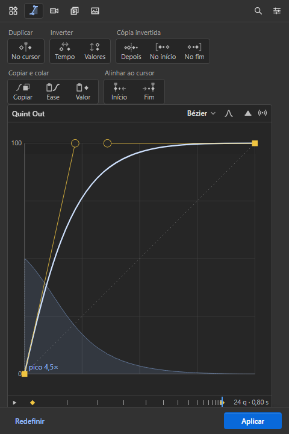
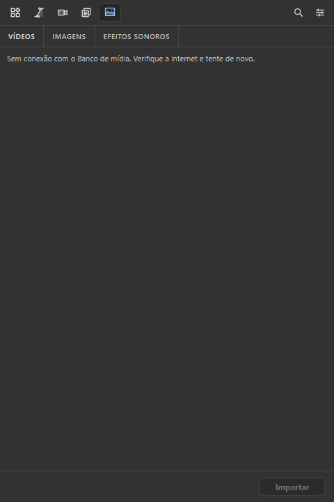

# Moti.on — Plano de desempenho, design system e acabamento do painel

Projeto: `C:\dev\Moti.on\implementation` (painel CEP do After Effects).
Data: 2026-11-16. Estado: janela virtual da Fase 1 medida no After Effects. Veja as medições e pendências em "Andamento".

## 1. Contexto

O objetivo é não perder usuários: o painel precisa responder na hora, mostrar carregamento só quando for inevitável, funcionar em qualquer largura de dock e ter um visual mais atraente e profissional, na linha do After Effects. Pedidos desta rodada:

- Slider de tamanho e rolagem dos presets estão travados (os dois, confirmado).
- Botões e partes do layout pesados.
- Telas/animações de carregamento onde a espera é inevitável (último recurso).
- Design system com tokens; botões, sliders, pop-ups e barra de busca mais compactos e profissionais.
- Desfoque em parte da interface.
- **Cor de destaque escolhida pelo próprio usuário do plugin** (decisão desta conversa), com azul Moti.on mais vivo como padrão.
- Varredura de bugs visuais e revisão da estrutura do código.

Regras que continuam valendo (retornos anteriores): manter cerca de 70% do visual atual, partir do painel real, densidade de painel AE (controles de 24–28 px), nada com cara de app de celular, cada largura (280/360/480/720) com layout próprio, sem linha de seleção.

## 2. Diagnóstico (o que achei no código)

Estado atual, capturas de hoje (`artifacts/layout-sprints/icones-20261116/`):

| Presets 480 | Presets 280 | Ferramentas 360 |
|---|---|---|
|  |  |  |

| Suavização 480 | Banco de mídia 480 (sem conexão) |
|---|---|
|  |  |

### 2.1 Desempenho — verificado no código

| # | Achado | Onde | Efeito |
|---|---|---|---|
| D1 | A grade cria **todos** os cards de uma vez (473 em "Todos os presets"), sem janela virtual. Cada card tem SVG ou canvas, 3 botões e 5 ouvintes de evento próprios. | `preset-gallery.ts:1863-1926` (`draw`) | Rolagem pesada, troca de pasta lenta, memória alta |
| D2 | O slider de tamanho, a cada passo do arraste, grava a preferência e muda `--preview-size`, o que refaz o layout dos 473 cards (`grid auto-fill`) e dispara os dois IntersectionObservers. | `preset-gallery.ts:936-942`, `panel-preferences.ts:173`, `ae-design-system.css:420` | Slider travado |
| D3 | Favoritar um preset chama `draw()` e reconstrói a grade inteira. | `preset-gallery.ts:1918` | Clique na estrela demora |
| D4 | A busca refaz a grade inteira a cada pausa de 250 ms; `normalizeSearch` roda de novo para cada preset. | `preset-gallery.ts:453`, `:1891` | Digitação com engasgo |
| D5 | Nenhum card usa `content-visibility` ou `contain`; só o ladrilho de ferramenta tem `contain`. | `library-refinement.css:61` | Navegador pinta e mede o que está fora da tela |
| D6 | CSS final com 593 KB e 7.360 linhas, 21 arquivos empilhados, seletores longos (`[data-host] .ch-shell[data-layout] … `). | `dist/after-effects-cep/styles/theme.css`, `scripts/build.mjs:92-152` | Recalcular estilo custa caro em qualquer mudança de classe |
| D7 | `main.js` com 3,7 MB sem minificar. | `scripts/build-client.mjs:56` | Abertura do painel mais lenta (a medir) |
| D8 | `main.ts` tem 10.392 linhas e 238 funções; `preset-gallery.ts` 1.975 linhas com várias instruções por linha. | `apps/after-effects-cep/client/src/` | Difícil de corrigir sem quebrar |

Hipóteses a confirmar medindo dentro do AE (não verificadas): peso real de D6 e D7 no tempo de abertura; quanto os dois `backdrop-filter` já existentes (`components.css:423,446`) custam; quais botões específicos estão lentos (suspeita: os que esperam `evalScript` sem resposta visual imediata).

### 2.2 Design system — verificado no código

- **Três camadas de tokens que se repetem**: `ui-tokens/src/tokens.css` (233 variáveis), cópia quase igual em `ui-core/src/theme.css` (259) e apelidos `--ds-*` em `ae-design-system.css`. Mais apelidos `--ch-*`.
- **Cores fixas fora dos tokens**: 114 em `theme.css`, 65 em `ae-composer-browse.css`, 51 em `ae-browse-polish.css`, 47 em `ae-quick-actions.css`.
- **Mesmo componente estilizado em vários arquivos**: o slider tem regras em 6 arquivos (`ae-workstation`, `ae-layout`, `ae-composer-browse`, `ae-micro`, `ae-refinement`, `ae-design-system`); o card de preset tem 73 blocos de regra; a busca tem 10 classes diferentes (`ch-preset-search`, `ch-library-search`, `ch-quick-search`, `ch-stock-search`, `ch-field--search`…).
- **`!important` para vencer camadas antigas**: 30 em `ae-composer-browse.css`, 14 em `ae-design-system.css`.
- **Destaque sem identidade**: `--accent` é cinza-claro (`#e2e2e2`); o azul (`#0969DA` / `#58A6FF`) aparece só em ações.
- **Escala de movimento achatada**: `--motion-fast` e `--motion-standard` são ambos 200 ms.
- Não há Web Components reais; os componentes são funções que montam DOM (`ui-core/src/components.ts`, 1.099 linhas). Isso fica como está: trocar de modelo não traz ganho aqui.

### 2.3 Bugs visuais e de experiência vistos nas capturas

- 280 px: os filtros Tipografia/Motion/Transições viram três faixas de largura total e empurram a grade para baixo.
- 480 px: a dica "Presets 4" cobre as abas Navegar/… .
- Banco de mídia sem conexão: uma linha de texto solta, sem ícone, sem botão "Tentar de novo", fundo mais claro que o resto do painel.
- Nomes de preset cortados cedo ("Arco coreografa…") com espaço gasto por dois ícones fixos.
- Carregamento: já existem spinner e esqueleto em `components.ts`/`components.css`, mas a grade de presets e o banco de mídia não os usam de forma consistente.

### 2.4 Risco de base

`C:\dev\Moti.on` **não é um repositório git**. Várias rodadas de trabalho estão sem commit. Antes de mexer em desempenho e CSS em massa, isso precisa de um ponto de retorno.

## 3. Plano por fases

Cada fase termina instalável e verificada; nenhuma depende de terminar todas. Ao executar: usar as skills do projeto `optimizing-crosshost-performance`, `designing-adobe-workstation-ui`, `building-crosshost-panel-ui` e `testing-adobe-hosts` (exigência do `CLAUDE.md`).

### Fase 0 — Base segura e régua de medição

1. Salvar este plano em `docs/PLANO_UI_DESEMPENHO_2026-11.md` com as imagens copiadas para `docs/evidence/plano-ui-2026-11/` (caminhos relativos), e ir marcando o que foi feito.
2. `git init` em `C:\dev\Moti.on\implementation` com `.gitignore` (node_modules, dist, artifacts pesados) e um commit do estado atual. **Só com o seu OK.**
3. Medição dentro do AE via CDP (porta 8091, método já usado em 2026-11-13): gravar números de antes para
   - arrastar o slider de tamanho (quadros acima de 34 ms),
   - rolar "Todos os presets" (FPS p50/p90),
   - favoritar, buscar, trocar de pasta, trocar de aba (ms até pintar),
   - abrir o painel (ms até a primeira tela utilizável).
4. Transformar os scripts de medição em `scripts/panel-perf-audit.mjs` (hoje ficaram em pasta temporária) com saída em JSON, para comparar antes/depois.
5. Metas: interação responde em até 100 ms; arraste e rolagem sem quadro acima de 34 ms; troca de aba em até 150 ms; abertura do painel em até 1 s.

### Fase 1 — Galeria de presets rápida (o que você sente hoje)

Arquivo principal: `apps/after-effects-cep/client/src/preset-gallery.ts`.

1. **Slider de tamanho (D2)**: durante o arraste, só atualizar `--preview-size` uma vez por quadro (`requestAnimationFrame`) e pausar as prévias; gravar a preferência só ao soltar (evento `change`). Travar o número de colunas enquanto arrasta e reorganizar ao soltar, se a medição mostrar que o reflow ainda pesa.
2. **Cards fora da tela baratos (D5)**: `content-visibility:auto` + `contain-intrinsic-size` no card (o Chromium do CEP, alvo `chrome88`, suporta) e `contain:layout paint style`.
3. **Grade em janela (D1)**: renderizar só as linhas visíveis mais uma margem, com espaçadores em cima e embaixo. A grade tem cards de tamanho igual, então o cálculo é direto (`cardWidth` já existe na linha 924). Preservar: restauração de rolagem (`rememberScroll`/`restoreScroll`), foco por teclado (`focusKey`), gaveta de variações presa ao card e os observers de prévia.
   - Passo intermediário se a janela virtual se mostrar arriscada: montar em lotes (primeiras 2 telas na hora, resto em `requestIdleCallback`).
4. **Um ouvinte por grade, não cinco por card**: delegar `click`, `dblclick`, `contextmenu` no `grid`.
5. **Favoritar sem redesenhar (D3)**: trocar só `aria-pressed` e o ícone do card; redesenhar apenas quando o filtro ativo for "Favoritos".
6. **Busca (D4)**: índice de texto normalizado montado uma vez por idioma; filtrar escondendo/mostrando em vez de recriar; baixar a espera de 250 para ~120 ms.
7. **Troca de pasta**: reaproveitar nós de card (pool) em vez de `clearNode` + criar tudo.
8. Testes novos em `tests/` para: número de nós na grade limitado, favoritar não recria cards, slider não grava preferência durante o arraste. Usar `domSafeAssert` (asserções nó-contra-nó estouram memória no DOM falso).

### Fase 2 — Desempenho geral do painel

1. **Resposta imediata em todo botão que chama o AE**: estado pressionado/ocupado no mesmo quadro do clique, antes do `evalScript` (padrão `aria-busy` já existe em `action-button-view.ts`). Levantar com `host-feedback.ts` quais ações hoje ficam mudas.
2. **CSS (D6)**: resultado da Fase 3; meta de cortar o arquivo final pela metade e encurtar seletores.
3. **Abertura (D7)**: medir com e sem minificação; se ganhar, minificar com `keepNames` e gerar sourcemap separado. Montar só a aba ativa na abertura e as outras no primeiro uso (verificar o que `start()` em `main.ts:1873` monta de cara).
4. **Animações**: só `transform` e `opacity`; `will-change` apenas durante a animação (já é assim em `motion.css:6`, estender às camadas AE).
5. **Trabalho pesado fora da hora do clique**: catálogo e índices preparados em tempo ocioso.

### Fase 3 — Design system: tokens e cor de destaque do usuário

Antes de codar: **estudo visual sobre o painel real** (mesmo método das rodadas aprovadas: CSS/DOM do `dist`, nas 4 larguras) mostrando antes/depois de tokens, botões, slider, busca, pop-up e seletor de cor. Você aprova o estudo, depois eu implemento.

1. **Uma fonte de tokens** em `packages/ui-tokens/src/tokens.css`, em três níveis:
   - primitivos (cinzas, escala de azul, espaços 2/4/6/8/12/16, raios 2/4/6, tipos 11/12/13),
   - semânticos (`--surface-*`, `--text-*`, `--line-*`, `--accent-*`, `--focus-ring`, `--elev-1..3`, `--motion-*`),
   - de componente (`--btn-h`, `--field-h`, `--slider-track`, `--card-radius`…).
   Remover a cópia de `theme.css` e os apelidos `--ds-*`/`--ch-*` aos poucos (com teste em `ui-tokens/tests/tokens.test.mjs` impedindo variável duplicada).
2. **Cor de destaque escolhida pelo usuário**:
   - Em Ajustes → Aparência: 6–8 cores prontas (Azul Moti.on vivo como padrão, mais violeta, ciano, verde, âmbar, rosa, "seguir o AE") e um campo de cor livre.
   - Da cor escolhida saem em JavaScript os derivados: hover, pressionado, lavagem translúcida, texto sobre o destaque e anel de foco. Precisa ser em JS porque o Chromium do CEP não tem `color-mix()`. Local: `host-theme.ts` (já alimenta variáveis do tema) + preferência nova em `panel-preferences.ts`.
   - Trava de contraste: se a cor escolhida não atingir 4,5:1 no texto ou 3:1 em controles sobre o fundo do painel, clarear/escurecer automaticamente o derivado (reaproveitar a conta de `ui-tokens/scripts/check-contrast.mjs`).
   - O destaque passa a ser usado de forma coerente: aba ativa, item selecionado, valor editável, preenchimento do slider, botão principal, foco, estrela de favorito fica como está.
3. **Movimento**: escala real (90 / 140 / 200 / 260 ms), duas curvas, e respeito a movimento reduzido já existente.
4. **Elevação e desfoque**: três níveis de sombra. Desfoque real **só em camadas pequenas e temporárias** (menus, pop-ups, paleta de busca, avisos), com fundo translúcido sólido como reserva. Barras fixas e cards continuam sólidos. Se a medição no AE mostrar queda de FPS, o desfoque sai e fica a reserva.
5. **Consolidar as 21 folhas** em: tokens → base → componentes (um arquivo por componente) → telas → tema AE. Migrar um componente por vez, apagando as regras antigas e os `!important` correspondentes, com comparação de captura a cada passo.

### Fase 4 — Componentes

Um componente por vez, cada um com todos os estados (normal, hover, pressionado, foco, selecionado, desativado, ocupado) e uma página de amostra `artifacts/…/componentes.html` para conferência.

| Componente | Hoje | Proposta |
|---|---|---|
| Botão | `.ch-button` em 223 regras, alturas variadas | 3 tamanhos (22/24/28), 4 variantes (principal, padrão, discreto, destrutivo), só ícone; estado ocupado embutido |
| Slider | 6 arquivos, trilho de 2 px cinza | Estilo AE: trilho fino com preenchimento na cor de destaque, pino pequeno, valor azul arrastável ao lado (reusar `scrubbable-number`), duplo clique volta ao padrão |
| Busca | 10 classes | Um campo compacto de 24 px: ícone, texto, limpar (×), filtro acoplado; atalho `Ctrl/Cmd+F`; no 280 px vira ícone que expande |
| Pop-up / menu | vários | Um casco único: raio 4, sombra nível 2, desfoque, animação de 140 ms a partir do ponto de origem, fecha com Esc e clique fora |
| Aviso (toast) | `host-feedback.ts` | Posição e duração padronizadas, com ação "Desfazer" quando couber |
| Card de preset | 73 regras | Nome com mais espaço (ações aparecem no hover/foco; estrela fica visível se marcada), selo de direção padronizado, realce na cor de destaque |
| Dica (tooltip) | `rich-tooltip.ts` | Nunca cobrir abas/controles vizinhos; atraso de 400 ms |
| Abas, segmentados, árvore, seções retráteis, barra de rolagem | — | Mesmos tokens de altura, raio e foco |

### Fase 5 — Carregamento, vazio e erro

Regra: até 100 ms não mostra nada; de 100 ms a 1 s mostra esqueleto ou indicador no próprio botão; acima de 1 s mostra progresso com texto e, se possível, cancelar. Carregamento de tela cheia só na abertura do painel, se a Fase 2 não a deixar abaixo de 1 s.

1. Grade de presets: esqueleto de cards com brilho leve enquanto monta; prévia com marcador até o clipe estar pronto.
2. Banco de mídia: esqueleto na busca, progresso no download/importação, e tela de erro com ícone, explicação e botão "Tentar de novo" (hoje é só uma linha de texto).
3. Aplicar preset/ferramenta: botão em estado ocupado + aviso de sucesso/erro.
4. Telas vazias com orientação: sem resultado de busca (com "Limpar busca"), sem favoritos, sem recentes, sem camada selecionada.
5. Componentes já existentes a reaproveitar: spinner e esqueleto de `components.ts`/`components.css`, `data-loading` de `ae-layout.css`.

### Fase 6 — Responsivo por largura e altura

1. Corrigir os filtros empilhados no 280 px (uma linha rolável ou menu).
2. Rodapé dos presets no 280 px: slider e ações sem aperto.
3. Conferir alturas baixas (painel acoplado com 300–400 px): barras fixas não podem comer a área útil.
4. Larguras acima de 720: usar coluna lateral, não esticar.
5. Auditoria com `node scripts/panel-layout-audit.mjs <rótulo>` em 280/360/480/720, somando duas alturas baixas ao script.

### Fase 7 — Varredura de bugs visuais

Passar tela por tela (Ferramentas, Suavização, Câmera, Presets, Banco de mídia, Ajustes, ajustes de cada ferramenta) com lista de conferência: texto cortado, sobreposição, foco invisível, contraste, alvo de clique menor que 24 px, alinhamento, texto em idioma misturado, tema claro/escuro do AE. Cada bug vira item no MD com captura antes/depois.

### Fase 8 — Estrutura do código

Sem mudar comportamento, com a suíte de testes como rede:

1. Fatiar `main.ts` (10.392 linhas) por tela: cada `renderXxx` (Wiggle, Flicker, Smooth, LoopOut, Anchor, CutKeys, Delay…) vai para `views/<ferramenta>.ts`; `main.ts` fica com a inicialização e o roteamento.
2. Fatiar `preset-gallery.ts` em: grade (janela virtual), card, barra lateral/pastas, rodapé, controle de prévias.
3. Formatação legível (uma instrução por linha) nos arquivos tocados.
4. Fatiar `components.ts` (1.099) e `shell.ts` (1.305) por componente, acompanhando a Fase 4.

## 4. Sugestões além do que você pediu

Ordenadas por retorno para não perder usuário:

1. **Primeira abertura guiada**: três dicas curtas sobre o painel real (onde ficam ferramentas, presets e busca), dispensáveis.
2. **"O que há de novo"** depois de cada atualização, a partir do `CHANGELOG.md`.
3. **Aviso de atualização dentro do painel** com um clique, em vez de depender do `.cmd`.
4. **Registro de erros e de lentidão** (opcional, com consentimento) usando `packages/logging`, para saber onde os usuários travam.
5. **Paleta de comandos** (`command-palette.ts` já existe) com atalho divulgado na interface e resultados de presets + ferramentas juntos.
6. **Aplicar com um gesto**: duplo clique já aplica; adicionar arrastar o card para a timeline se o CEP permitir (pesquisar antes).
7. **Prévia do preset com o texto/camada do usuário** quando houver seleção.
8. **Checagem de compatibilidade** na abertura (versão do AE, GPU) com mensagem clara em vez de falha muda.
9. **Modo compacto** opcional (controles de 22 px) para quem acopla o painel estreito.
10. **Orçamento de desempenho no `npm run check`**: tamanho máximo de CSS/JS e número máximo de nós na grade, para o painel não voltar a ficar pesado.

## 5. Ordem sugerida

Fase 0 → 1 (resolve o que trava hoje) → 3 (estudo visual + tokens + cor do usuário) → 4 e 5 juntas por componente → 6 → 7 → 2 e 8 intercaladas conforme os arquivos forem tocados.

## 6. Verificação

- A cada fase: `npm run check` (lint, tipos, build, validação, contraste, testes).
- Visual: `npm run build && node scripts/panel-layout-audit.mjs <rótulo>` e comparação com as capturas de `icones-20261116`.
- Desempenho: `scripts/panel-perf-audit.mjs` dentro do AE via CDP (porta 8091), comparando com os números da Fase 0. Medição no navegador comum não vale (aba oculta distorce).
- Instalação: copiar `dist/after-effects-cep/client` e `styles`, recarregar o painel com `location.reload()`.
- Tudo que não for conferido por você no After Effects fica marcado `IMPLEMENTED_NOT_HOST_VERIFIED`.
- Ao final, remover o `.debug` da pasta de extensões.

## 7. Andamento

### 2026-11-16 — Fase 0 e início da Fase 1

Feito:

- [x] Plano salvo em `docs/` com imagens.
- [x] Ponto de retorno: commit `6b40d47` no ramo atual (local, sem push).
- [x] `scripts/panel-perf-audit.mjs <rótulo>`: mede slider, rolagem, favoritar e busca dentro do AE (CDP 8091) e grava `artifacts/perf/<rótulo>.json`.
- [x] Fase 1.1 — slider de tamanho: atualiza a grade no máximo uma vez por quadro e grava a preferência só ao soltar.
- [x] Causa raiz do slider e do divisor de pastas: `--preview-size` e `--preset-sidebar-width` eram variáveis CSS herdadas; cada passo recalculava o estilo de todos os descendentes. Agora são registradas sem herança (`registerLayoutProperties` em `preset-gallery.ts`).
- [x] Fase 1.5 — favoritar atualiza a estrela no lugar (redesenha só no filtro "Favoritos").
- [x] Dois testes novos em `apps/after-effects-cep/tests/preset-gallery-ui.test.mjs`.

Medições:

| Cenário | Antes | Depois | Onde foi medido |
|---|---|---|---|
| Slider, um passo (estilo + layout) | 124 ms | 17 ms | preview local, Chrome 156, 473 cards, mediana de 9 |
| Slider, quadro por passo | p50 125 ms, 38 de 38 quadros acima de 34 ms | não medido | After Effects (Chromium 99), painel 231×238 |
| Divisor de pastas, um passo | não medido | 26 ms | preview local |
| Favoritar (código até devolver) | ~220 ms | 0,6 ms | antes: AE; depois: preview local |
| Favoritar até pintar | 370–470 ms | não medido | After Effects |
| Rolagem 9.000 px | p50 24 ms, p90 47 ms, 27 de 150 quadros acima de 34 ms | sem mudança esperada | After Effects |
| Busca: limpar o termo | quadro mais longo 203 ms | sem mudança | After Effects |

Nesta primeira rodada, a porta de depuração deixou de responder antes da medição do build otimizado no After Effects. A comparação da janela virtual abaixo usa uma nova medição com a correção do slider e dos favoritos já instalada na base.

Aprendizados que mudam o plano:

- O Chromium do painel no AE é o 99 (CEP 12), não o 88: `content-visibility`, `contain-intrinsic-size: auto` e `aspect-ratio` existem.
- A CSP do painel bloqueia `<style>` injetado; experimento de CSS ao vivo tem de ser por `element.style`.
- **Qualquer** `style.setProperty("--x")` em um contêiner grande custa ~100 ms por causa da herança. Vale para a Fase 3: tokens que mudam em tempo de uso (cor de destaque, tamanho) devem ser trocados uma vez, nunca durante arraste, ou registrados sem herança.
- Redesenhar a grade custa 120–220 ms de JavaScript puro (criar 473 cards). `content-visibility` não resolve isso; a janela virtual (Fase 1.3) continua necessária para busca, troca de pasta e rolagem.
- `content-visibility` nos cards cortou o layout do slider de 17 para 8 ms no preview, mas muda a altura estimada da rolagem. Fica para depois de medir no AE.
- A skill de desempenho do projeto pede espera de busca entre 250 e 400 ms: o item 1.6 mantém 250 ms (não baixar para 120).

### 2026-11-16 — Janela virtual no After Effects

- [x] Fase 1.3 — monta as linhas visíveis e até duas linhas de margem por lado. A grade CSS preserva a altura total com trilhas de altura fixa. Linhas com foco ou com uma gaveta aberta continuam montadas.
- [x] Fase 1.4 — cliques, duplo clique e menu de contexto delegados à grade. Os observers de prévia acompanham somente os cards montados.
- [x] Fase 1.5 — o menu de contexto também atualiza a estrela no lugar. O filtro Favoritos atualiza seus resultados ao desmarcar.
- [x] Fase 1.6 — texto de busca normalizado uma vez por idioma. O debounce fica em 250 ms e a contagem informa todos os resultados do filtro.
- [x] Fase 1.7 — reaproveita cards comuns entre pastas e mantém até 32 cards desmontados por galeria para reutilização. Libera a cena e desregistra os observers ao desmontar.
- [x] Fase 1.8 — cobertura automatizada para limite de nós, busca, reaproveitamento, observers, teclado, gaveta, restauração e revelação de presets fora da janela.
- [ ] Fase 1.2 — `content-visibility` e `contain` ficaram pendentes. A janela virtual já atingiu a meta de quadros no cenário medido.

As medições têm cinco rodadas após o aquecimento no After Effects 26.5, CEP 12.0.1 (Chromium 99), Windows 11, i7-14700KF e RTX 3080. Nos dois builds, o painel tinha 498 × 698 px (DPR 1), a grade 325 × 467 px em duas colunas, o slider estava em 230 px e o catálogo tinha 473 resultados. O ensaio percorreu 9.000 px e voltou, em passos de 120 px, no projeto vazio. Tempos de resposta visual foram estimados via `requestAnimationFrame`. Os valores da tabela são medianas das cinco rodadas, salvo onde consta o pior caso ou o total.

| Cenário | Antes da janela | Depois da janela |
|---|---:|---:|
| Cards montados no topo / a 9.000 px | 473 / 473 | 12 / 18 |
| Rolagem, tempo por quadro p50 / p90 | 53,4 / 96,3 ms | 6,4 / 8,9 ms |
| Rolagem, quadros acima de 34 ms (total) | 621 de 750 | 0 de 750 |
| Rolagem, pior quadro das cinco rodadas | 215,5 ms | 24,8 ms |
| Slider, tempo por quadro p50 / p90 | 77,4 / 118,8 ms | 5,7 / 11,8 ms |
| Slider, quadros acima de 34 ms (total) | 152 de 190 | 0 de 190 |
| Busca por `fade` / limpar (inclui 250 ms de debounce) | 295,0 / 805,9 ms | 271,3 / 273,6 ms |
| Limpar busca, quadro mais longo por rodada | 205,2 ms | 20,3 ms |
| Todos → Motion, clique até segundo quadro | 185,7 ms | 16,8 ms |
| Motion → Todos, clique até segundo quadro | 569,7 ms | 16,7 ms |

Os dois builds retornaram 5 itens para `fade`, 115 em Motion, 473 em Todos e a mesma extensão rolável de 27.659 px. Para repetir, use `node scripts/panel-perf-audit.mjs <rótulo> --compare=antes-janela`. A primeira medição após a alteração usou uma coluna por causa da largura do divisor e ficou fora da comparação.

- [Antes, cinco amostras](../artifacts/perf/antes-janela.json) e [depois, mesma grade](../artifacts/perf/depois-janela-mesma-grade.json).
- [Smoke no AE](../artifacts/perf/ae-janela-smoke.json), em três colunas. Home/End alcançaram o primeiro e o último preset, a gaveta manteve a âncora na rolagem, Escape devolveu o foco e retornar de Ferramentas para Presets restaurou os 9.000 px.
- Build medido, SHA-256 de `client/main.js` antes `6BBCAF852ECD544F88204C14F77C1ED8D6957ED0B6D4EBAAB8245FEE70752ACA` e depois `7A21F924D3A89ED5BEEBCFB62510FE924748C55EDDBF36C4135440F04909EBAF`.

### 2026-11-18 — Verificação final no painel instalado

- **PASS no After Effects 26.5.** No painel de 492 × 591 px em duas colunas, a roda do mouse percorreu 5.448 px e voltou ao primeiro card. Na coleção de 473 presets, ficaram montados 10 cards no topo e 16 durante a rolagem.
- **PASS na busca e nas pastas.** A digitação de `fade` encontrou 5 presets, um termo sem correspondência exibiu o estado vazio e apagar o texto restaurou os 473. A troca para Motion mostrou 115 presets e o retorno a Todos restaurou os 473. [Registro das interações no AE](../artifacts/perf/ae-fase1-interacao-20261118.json).
- O primeiro `npm run check` teve 3.102 testes aprovados e um seletor CSS sem escopo de host. A correção restringiu a regra ao After Effects. A coleta dirigida posterior passou em 207 testes, incluindo o teste que falhou. Build, lint, validação estrutural, contraste e validação das skills passaram. [Suíte anterior](../artifacts/perf/fase1-check-final.log), [testes após a correção](../artifacts/perf/fase1-focados-20261118.log) e [auditoria visual em 280/360/480/720 px](../artifacts/layout-sprints/fase1-janela-virtual/metrics.json).
- A instalação CEP foi conferida por SHA-256. `client/main.js` corresponde ao build medido acima. `styles/theme.css` instalado após a correção tem SHA-256 `6E3E8B93EE6AE9FF893CF791242313644506AC00AC9E06E8A9E397ABBD953636`. O arquivo temporário `.debug` foi removido da instalação.

### 2026-11-18 — Fase 3 no painel instalado

- A revisão visual foi aprovada com uma correção de cor. **Seguir o AE** é o padrão. As superfícies usam a paleta do host e os controles conservam as cores originais de ação. As seis amostras e a entrada hexadecimal ficam em Configurações → Aparência para escolha manual.
- Busca de 24 px com limpar, slider com valor editável e arrastável, atalhos em uma linha no painel compacto e controles secundários dos cards visíveis ao selecionar, passar o mouse ou focar. O desfoque de 7 px fica nos pop-ups cobertos pelo estudo, com uma superfície sólida como fallback.
- **PASS no After Effects 26.5x89** em 280 × 640, 360 × 720, 480 × 800 e 720 × 900 px da área interna do CEP. A galeria usou o RGB 30/30/30 do host em todas as larguras. Foram verificados rolagem virtual, busca, limpar, troca de pasta, slider, menu do card e seletor de cor. [Resultados e métricas](../artifacts/fase3-validacao-20261118/verificacao-ae.json).
- **PASS para persistência e contraste**. Violeta voltou após recarregar o painel. O campo rejeitou um valor inválido, manteve o hexadecimal escolhido ao ajustar o contraste e voltou às cores do After Effects com Seguir o AE.
- Build, lint, validação estrutural, contraste e 124 testes focados passaram. A primeira execução de `npm run check` teve três falhas de busca e Configurações. Os três casos passaram na reexecução focada após as correções. A consolidação do CSS ficou para a rodada seguinte.
- O build validado ficou instalado e aberto em Presets → Navegar na sessão de teste. SHA-256 de `client/main.js` `367A8E49D946C04473DCB00C879494BCC3E274CCC631C0FBD0849F74D4709AF9` e de `styles/theme.css` `48B69D8272923C3DA5AEA2F3D963FB21D96607E644624C567A646D25CC3B9145`.

### 2026-11-18 — Consolidação do CSS da Fase 3

- O build lê os tokens canônicos antes da folha base. Os controles da biblioteca, as prévias de ferramentas e os estilos da galeria foram reunidos por uso. Foram removidas 88 declarações redundantes, incluindo duas com `!important`. A ordem das folhas está em `scripts/theme-sources.mjs`.
- A folha distribuída do AE passou de 609.578 para 541.723 bytes (−11,1%). O Chromium 99 do CEP produziu a mesma cascata de apresentação após normalizar as duplicatas. O CSS do Premiere permaneceu idêntico byte a byte. A meta inicial de cortar o arquivo pela metade segue pendente.
- After Effects 26.5, no painel CEP instalado, em 280×640, 360×720, 480×800 e 720×900 px. Passaram rolagem virtual, busca, troca de pasta, slider, menu do cartão e paleta. O fundo da galeria coincidiu com o do host em todas as larguras (`#1e1e1e` na sessão testada). As capturas estabilizadas da galeria, do menu, da busca e da paleta coincidiram nas quatro larguras. [Registro de roda, digitação e cliques em pasta](../artifacts/fase3-css-20261118/interacao-cep.json).
- A versão de teste foi instalada atualizando a folha CSS da extensão existente. [Medições no host](../artifacts/fase3-css-20261118/depois/verificacao-ae.json), [comparação visual](../artifacts/fase3-css-20261118/comparativo-mesmo-estado.json) e [SHA-256 da instalação](../artifacts/fase3-css-20261118/instalacao.json).
- Build, lint, validação estrutural e os 282 pares de contraste passaram. A primeira execução aprovou os 12 testes longos de paridade de prévias e revelou as referências antigas à folha CSS. Após atualizar os testes e reconstruir o pacote, os outros 3.108 testes passaram. [Primeira execução](../artifacts/fase3-css-20261118/check.log) e [revalidação](../artifacts/fase3-css-20261118/testes-final.log).

### 2026-11-18 — Fase 4, botão

- O componente ganhou os tamanhos de 22, 24 e 28 px. A folha do AE usa a paleta já ativa para as variantes, foco, seleção e estados. O indicador de progresso aparece dentro do botão e o texto de estado continua anunciado. No grupo de fases, o indicador ocupa temporariamente o espaço visual do rótulo para manter a largura do botão.
- **PASS no After Effects 26.5 instalado** em 280×640, 360×720, 480×800 e 720×900 px. Wiggle aplicou a expressão à opacidade e **Ambos** aplicou Arco coreografado. Foram observados foco por teclado, progresso sem deslocamento e uma execução de cada comando por rodada. As quatro composições descartáveis foram removidas ao terminar. [Interações no AE](../artifacts/fase4-botao-implementado-20261118/verificacao-ae.json) e [amostra renderizada pelo CSS instalado](../artifacts/fase4-botao-implementado-20261118/estados-ae.json).
- A instalação atualiza o cliente e o CSS. O host anterior passou na comparação direta de Arco coreografado. O host recém-gerado registrou `HOST_OPERATION_FAILED` ao avaliar a expressão de fase desse preset. A validação final usou o host que passou. [Comparação de hosts](../artifacts/fase4-botao-implementado-20261118/arco-host.json) e [SHA-256 da instalação](../artifacts/fase4-botao-implementado-20261118/instalacao.json).
- O build exigiu uma correção pontual na validação dos dois campos decodificados em `expression-compose.jsx`. Build, lint, validação estrutural e contraste passaram. Os 12 testes de paridade passaram na execução longa e os demais 3.115 passaram na revalidação final. [Execução longa](../artifacts/fase4-botao-implementado-20261118/check.log) e [revalidação](../artifacts/fase4-botao-implementado-20261118/testes-revalidacao.log).
