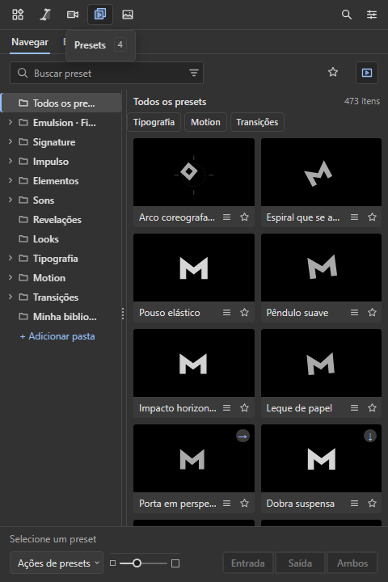
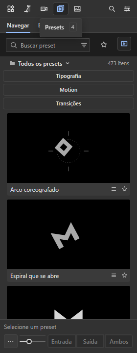
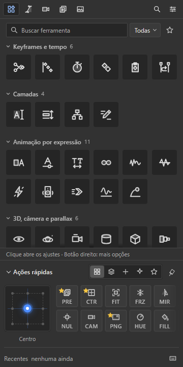

# Moti.on — Plano de desempenho, design system e acabamento do painel

Projeto: `C:\dev\Moti.on\implementation` (painel CEP do After Effects).
Data: 2026-11-16. Estado: plano aprovado, nada implementado. Marque cada item com [x] conforme for entregue.

## 1. Contexto

O objetivo é não perder usuários: o painel precisa responder na hora, mostrar carregamento só quando for inevitável, funcionar em qualquer largura de dock e ter um visual mais atraente e profissional, na linha do After Effects. Pedidos desta rodada:

- Slider de tamanho e rolagem dos presets estão travados (os dois, confirmado).
- Botões e partes do layout pesados.
- Telas/animações de carregamento onde a espera é inevitável (último recurso).
- Design system com tokens; botões, sliders, pop-ups e barra de busca mais compactos e profissionais.
- Desfoque em parte da interface.
- **Cor de destaque escolhida pelo próprio usuário do plugin** (decisão desta conversa), com azul Moti.on mais vivo como padrão.
- Varredura de bugs visuais e revisão da estrutura do código.

Regras que continuam valendo (retornos anteriores): manter cerca de 70% do visual atual, partir do painel real, densidade de painel AE (controles de 24–28 px), nada com cara de app de celular, cada largura (280/360/480/720) com layout próprio, sem linha de seleção.

## 2. Diagnóstico (o que achei no código)

Estado atual, capturas de hoje (`artifacts/layout-sprints/icones-20261116/`):

| Presets 480 | Presets 280 | Ferramentas 360 |
|---|---|---|
|  |  |  |

| Suavização 480 | Banco de mídia 480 (sem conexão) |
|---|---|
|  |  |

### 2.1 Desempenho — verificado no código

| # | Achado | Onde | Efeito |
|---|---|---|---|
| D1 | A grade cria **todos** os cards de uma vez (473 em "Todos os presets"), sem janela virtual. Cada card tem SVG ou canvas, 3 botões e 5 ouvintes de evento próprios. | `preset-gallery.ts:1863-1926` (`draw`) | Rolagem pesada, troca de pasta lenta, memória alta |
| D2 | O slider de tamanho, a cada passo do arraste, grava a preferência e muda `--preview-size`, o que refaz o layout dos 473 cards (`grid auto-fill`) e dispara os dois IntersectionObservers. | `preset-gallery.ts:936-942`, `panel-preferences.ts:173`, `ae-design-system.css:420` | Slider travado |
| D3 | Favoritar um preset chama `draw()` e reconstrói a grade inteira. | `preset-gallery.ts:1918` | Clique na estrela demora |
| D4 | A busca refaz a grade inteira a cada pausa de 250 ms; `normalizeSearch` roda de novo para cada preset. | `preset-gallery.ts:453`, `:1891` | Digitação com engasgo |
| D5 | Nenhum card usa `content-visibility` ou `contain`; só o ladrilho de ferramenta tem `contain`. | `library-refinement.css:61` | Navegador pinta e mede o que está fora da tela |
| D6 | CSS final com 593 KB e 7.360 linhas, 21 arquivos empilhados, seletores longos (`[data-host] .ch-shell[data-layout] … `). | `dist/after-effects-cep/styles/theme.css`, `scripts/build.mjs:92-152` | Recalcular estilo custa caro em qualquer mudança de classe |
| D7 | `main.js` com 3,7 MB sem minificar. | `scripts/build-client.mjs:56` | Abertura do painel mais lenta (a medir) |
| D8 | `main.ts` tem 10.392 linhas e 238 funções; `preset-gallery.ts` 1.975 linhas com várias instruções por linha. | `apps/after-effects-cep/client/src/` | Difícil de corrigir sem quebrar |

Hipóteses a confirmar medindo dentro do AE (não verificadas): peso real de D6 e D7 no tempo de abertura; quanto os dois `backdrop-filter` já existentes (`components.css:423,446`) custam; quais botões específicos estão lentos (suspeita: os que esperam `evalScript` sem resposta visual imediata).

### 2.2 Design system — verificado no código

- **Três camadas de tokens que se repetem**: `ui-tokens/src/tokens.css` (233 variáveis), cópia quase igual em `ui-core/src/theme.css` (259) e apelidos `--ds-*` em `ae-design-system.css`. Mais apelidos `--ch-*`.
- **Cores fixas fora dos tokens**: 114 em `theme.css`, 65 em `ae-composer-browse.css`, 51 em `ae-browse-polish.css`, 47 em `ae-quick-actions.css`.
- **Mesmo componente estilizado em vários arquivos**: o slider tem regras em 6 arquivos (`ae-workstation`, `ae-layout`, `ae-composer-browse`, `ae-micro`, `ae-refinement`, `ae-design-system`); o card de preset tem 73 blocos de regra; a busca tem 10 classes diferentes (`ch-preset-search`, `ch-library-search`, `ch-quick-search`, `ch-stock-search`, `ch-field--search`…).
- **`!important` para vencer camadas antigas**: 30 em `ae-composer-browse.css`, 14 em `ae-design-system.css`.
- **Destaque sem identidade**: `--accent` é cinza-claro (`#e2e2e2`); o azul (`#0969DA` / `#58A6FF`) aparece só em ações.
- **Escala de movimento achatada**: `--motion-fast` e `--motion-standard` são ambos 200 ms.
- Não há Web Components reais; os componentes são funções que montam DOM (`ui-core/src/components.ts`, 1.099 linhas). Isso fica como está: trocar de modelo não traz ganho aqui.

### 2.3 Bugs visuais e de experiência vistos nas capturas

- 280 px: os filtros Tipografia/Motion/Transições viram três faixas de largura total e empurram a grade para baixo.
- 480 px: a dica "Presets 4" cobre as abas Navegar/… .
- Banco de mídia sem conexão: uma linha de texto solta, sem ícone, sem botão "Tentar de novo", fundo mais claro que o resto do painel.
- Nomes de preset cortados cedo ("Arco coreografa…") com espaço gasto por dois ícones fixos.
- Carregamento: já existem spinner e esqueleto em `components.ts`/`components.css`, mas a grade de presets e o banco de mídia não os usam de forma consistente.

### 2.4 Risco de base

`C:\dev\Moti.on` **não é um repositório git**. Várias rodadas de trabalho estão sem commit. Antes de mexer em desempenho e CSS em massa, isso precisa de um ponto de retorno.

## 3. Plano por fases

Cada fase termina instalável e verificada; nenhuma depende de terminar todas. Ao executar: usar as skills do projeto `optimizing-crosshost-performance`, `designing-adobe-workstation-ui`, `building-crosshost-panel-ui` e `testing-adobe-hosts` (exigência do `CLAUDE.md`).

### Fase 0 — Base segura e régua de medição

1. Salvar este plano em `docs/PLANO_UI_DESEMPENHO_2026-11.md` com as imagens copiadas para `docs/evidence/plano-ui-2026-11/` (caminhos relativos), e ir marcando o que foi feito.
2. `git init` em `C:\dev\Moti.on\implementation` com `.gitignore` (node_modules, dist, artifacts pesados) e um commit do estado atual. **Só com o seu OK.**
3. Medição dentro do AE via CDP (porta 8091, método já usado em 2026-11-13): gravar números de antes para
   - arrastar o slider de tamanho (quadros acima de 34 ms),
   - rolar "Todos os presets" (FPS p50/p90),
   - favoritar, buscar, trocar de pasta, trocar de aba (ms até pintar),
   - abrir o painel (ms até a primeira tela utilizável).
4. Transformar os scripts de medição em `scripts/panel-perf-audit.mjs` (hoje ficaram em pasta temporária) com saída em JSON, para comparar antes/depois.
5. Metas: interação responde em até 100 ms; arraste e rolagem sem quadro acima de 34 ms; troca de aba em até 150 ms; abertura do painel em até 1 s.

### Fase 1 — Galeria de presets rápida (o que você sente hoje)

Arquivo principal: `apps/after-effects-cep/client/src/preset-gallery.ts`.

1. **Slider de tamanho (D2)**: durante o arraste, só atualizar `--preview-size` uma vez por quadro (`requestAnimationFrame`) e pausar as prévias; gravar a preferência só ao soltar (evento `change`). Travar o número de colunas enquanto arrasta e reorganizar ao soltar, se a medição mostrar que o reflow ainda pesa.
2. **Cards fora da tela baratos (D5)**: `content-visibility:auto` + `contain-intrinsic-size` no card (o Chromium do CEP, alvo `chrome88`, suporta) e `contain:layout paint style`.
3. **Grade em janela (D1)**: renderizar só as linhas visíveis mais uma margem, com espaçadores em cima e embaixo. A grade tem cards de tamanho igual, então o cálculo é direto (`cardWidth` já existe na linha 924). Preservar: restauração de rolagem (`rememberScroll`/`restoreScroll`), foco por teclado (`focusKey`), gaveta de variações presa ao card e os observers de prévia.
   - Passo intermediário se a janela virtual se mostrar arriscada: montar em lotes (primeiras 2 telas na hora, resto em `requestIdleCallback`).
4. **Um ouvinte por grade, não cinco por card**: delegar `click`, `dblclick`, `contextmenu` no `grid`.
5. **Favoritar sem redesenhar (D3)**: trocar só `aria-pressed` e o ícone do card; redesenhar apenas quando o filtro ativo for "Favoritos".
6. **Busca (D4)**: índice de texto normalizado montado uma vez por idioma; filtrar escondendo/mostrando em vez de recriar; baixar a espera de 250 para ~120 ms.
7. **Troca de pasta**: reaproveitar nós de card (pool) em vez de `clearNode` + criar tudo.
8. Testes novos em `tests/` para: número de nós na grade limitado, favoritar não recria cards, slider não grava preferência durante o arraste. Usar `domSafeAssert` (asserções nó-contra-nó estouram memória no DOM falso).

### Fase 2 — Desempenho geral do painel

1. **Resposta imediata em todo botão que chama o AE**: estado pressionado/ocupado no mesmo quadro do clique, antes do `evalScript` (padrão `aria-busy` já existe em `action-button-view.ts`). Levantar com `host-feedback.ts` quais ações hoje ficam mudas.
2. **CSS (D6)**: resultado da Fase 3; meta de cortar o arquivo final pela metade e encurtar seletores.
3. **Abertura (D7)**: medir com e sem minificação; se ganhar, minificar com `keepNames` e gerar sourcemap separado. Montar só a aba ativa na abertura e as outras no primeiro uso (verificar o que `start()` em `main.ts:1873` monta de cara).
4. **Animações**: só `transform` e `opacity`; `will-change` apenas durante a animação (já é assim em `motion.css:6`, estender às camadas AE).
5. **Trabalho pesado fora da hora do clique**: catálogo e índices preparados em tempo ocioso.

### Fase 3 — Design system: tokens e cor de destaque do usuário

Antes de codar: **estudo visual sobre o painel real** (mesmo método das rodadas aprovadas: CSS/DOM do `dist`, nas 4 larguras) mostrando antes/depois de tokens, botões, slider, busca, pop-up e seletor de cor. Você aprova o estudo, depois eu implemento.

1. **Uma fonte de tokens** em `packages/ui-tokens/src/tokens.css`, em três níveis:
   - primitivos (cinzas, escala de azul, espaços 2/4/6/8/12/16, raios 2/4/6, tipos 11/12/13),
   - semânticos (`--surface-*`, `--text-*`, `--line-*`, `--accent-*`, `--focus-ring`, `--elev-1..3`, `--motion-*`),
   - de componente (`--btn-h`, `--field-h`, `--slider-track`, `--card-radius`…).
   Remover a cópia de `theme.css` e os apelidos `--ds-*`/`--ch-*` aos poucos (com teste em `ui-tokens/tests/tokens.test.mjs` impedindo variável duplicada).
2. **Cor de destaque escolhida pelo usuário**:
   - Em Ajustes → Aparência: 6–8 cores prontas (Azul Moti.on vivo como padrão, mais violeta, ciano, verde, âmbar, rosa, "seguir o AE") e um campo de cor livre.
   - Da cor escolhida saem em JavaScript os derivados: hover, pressionado, lavagem translúcida, texto sobre o destaque e anel de foco. Precisa ser em JS porque o Chromium do CEP não tem `color-mix()`. Local: `host-theme.ts` (já alimenta variáveis do tema) + preferência nova em `panel-preferences.ts`.
   - Trava de contraste: se a cor escolhida não atingir 4,5:1 no texto ou 3:1 em controles sobre o fundo do painel, clarear/escurecer automaticamente o derivado (reaproveitar a conta de `ui-tokens/scripts/check-contrast.mjs`).
   - O destaque passa a ser usado de forma coerente: aba ativa, item selecionado, valor editável, preenchimento do slider, botão principal, foco, estrela de favorito fica como está.
3. **Movimento**: escala real (90 / 140 / 200 / 260 ms), duas curvas, e respeito a movimento reduzido já existente.
4. **Elevação e desfoque**: três níveis de sombra. Desfoque real **só em camadas pequenas e temporárias** (menus, pop-ups, paleta de busca, avisos), com fundo translúcido sólido como reserva. Barras fixas e cards continuam sólidos. Se a medição no AE mostrar queda de FPS, o desfoque sai e fica a reserva.
5. **Consolidar as 21 folhas** em: tokens → base → componentes (um arquivo por componente) → telas → tema AE. Migrar um componente por vez, apagando as regras antigas e os `!important` correspondentes, com comparação de captura a cada passo.

### Fase 4 — Componentes

Um componente por vez, cada um com todos os estados (normal, hover, pressionado, foco, selecionado, desativado, ocupado) e uma página de amostra `artifacts/…/componentes.html` para conferência.

| Componente | Hoje | Proposta |
|---|---|---|
| Botão | `.ch-button` em 223 regras, alturas variadas | 3 tamanhos (22/24/28), 4 variantes (principal, padrão, discreto, destrutivo), só ícone; estado ocupado embutido |
| Slider | 6 arquivos, trilho de 2 px cinza | Estilo AE: trilho fino com preenchimento na cor de destaque, pino pequeno, valor azul arrastável ao lado (reusar `scrubbable-number`), duplo clique volta ao padrão |
| Busca | 10 classes | Um campo compacto de 24 px: ícone, texto, limpar (×), filtro acoplado; atalho `Ctrl/Cmd+F`; no 280 px vira ícone que expande |
| Pop-up / menu | vários | Um casco único: raio 4, sombra nível 2, desfoque, animação de 140 ms a partir do ponto de origem, fecha com Esc e clique fora |
| Aviso (toast) | `host-feedback.ts` | Posição e duração padronizadas, com ação "Desfazer" quando couber |
| Card de preset | 73 regras | Nome com mais espaço (ações aparecem no hover/foco; estrela fica visível se marcada), selo de direção padronizado, realce na cor de destaque |
| Dica (tooltip) | `rich-tooltip.ts` | Nunca cobrir abas/controles vizinhos; atraso de 400 ms |
| Abas, segmentados, árvore, seções retráteis, barra de rolagem | — | Mesmos tokens de altura, raio e foco |

### Fase 5 — Carregamento, vazio e erro

Regra: até 100 ms não mostra nada; de 100 ms a 1 s mostra esqueleto ou indicador no próprio botão; acima de 1 s mostra progresso com texto e, se possível, cancelar. Carregamento de tela cheia só na abertura do painel, se a Fase 2 não a deixar abaixo de 1 s.

1. Grade de presets: esqueleto de cards com brilho leve enquanto monta; prévia com marcador até o clipe estar pronto.
2. Banco de mídia: esqueleto na busca, progresso no download/importação, e tela de erro com ícone, explicação e botão "Tentar de novo" (hoje é só uma linha de texto).
3. Aplicar preset/ferramenta: botão em estado ocupado + aviso de sucesso/erro.
4. Telas vazias com orientação: sem resultado de busca (com "Limpar busca"), sem favoritos, sem recentes, sem camada selecionada.
5. Componentes já existentes a reaproveitar: spinner e esqueleto de `components.ts`/`components.css`, `data-loading` de `ae-layout.css`.

### Fase 6 — Responsivo por largura e altura

1. Corrigir os filtros empilhados no 280 px (uma linha rolável ou menu).
2. Rodapé dos presets no 280 px: slider e ações sem aperto.
3. Conferir alturas baixas (painel acoplado com 300–400 px): barras fixas não podem comer a área útil.
4. Larguras acima de 720: usar coluna lateral, não esticar.
5. Auditoria com `node scripts/panel-layout-audit.mjs <rótulo>` em 280/360/480/720, somando duas alturas baixas ao script.

### Fase 7 — Varredura de bugs visuais

Passar tela por tela (Ferramentas, Suavização, Câmera, Presets, Banco de mídia, Ajustes, ajustes de cada ferramenta) com lista de conferência: texto cortado, sobreposição, foco invisível, contraste, alvo de clique menor que 24 px, alinhamento, texto em idioma misturado, tema claro/escuro do AE. Cada bug vira item no MD com captura antes/depois.

### Fase 8 — Estrutura do código

Sem mudar comportamento, com a suíte de testes como rede:

1. Fatiar `main.ts` (10.392 linhas) por tela: cada `renderXxx` (Wiggle, Flicker, Smooth, LoopOut, Anchor, CutKeys, Delay…) vai para `views/<ferramenta>.ts`; `main.ts` fica com a inicialização e o roteamento.
2. Fatiar `preset-gallery.ts` em: grade (janela virtual), card, barra lateral/pastas, rodapé, controle de prévias.
3. Formatação legível (uma instrução por linha) nos arquivos tocados.
4. Fatiar `components.ts` (1.099) e `shell.ts` (1.305) por componente, acompanhando a Fase 4.

## 4. Sugestões além do que você pediu

Ordenadas por retorno para não perder usuário:

1. **Primeira abertura guiada**: três dicas curtas sobre o painel real (onde ficam ferramentas, presets e busca), dispensáveis.
2. **"O que há de novo"** depois de cada atualização, a partir do `CHANGELOG.md`.
3. **Aviso de atualização dentro do painel** com um clique, em vez de depender do `.cmd`.
4. **Registro de erros e de lentidão** (opcional, com consentimento) usando `packages/logging`, para saber onde os usuários travam.
5. **Paleta de comandos** (`command-palette.ts` já existe) com atalho divulgado na interface e resultados de presets + ferramentas juntos.
6. **Aplicar com um gesto**: duplo clique já aplica; adicionar arrastar o card para a timeline se o CEP permitir (pesquisar antes).
7. **Prévia do preset com o texto/camada do usuário** quando houver seleção.
8. **Checagem de compatibilidade** na abertura (versão do AE, GPU) com mensagem clara em vez de falha muda.
9. **Modo compacto** opcional (controles de 22 px) para quem acopla o painel estreito.
10. **Orçamento de desempenho no `npm run check`**: tamanho máximo de CSS/JS e número máximo de nós na grade, para o painel não voltar a ficar pesado.

## 5. Ordem sugerida

Fase 0 → 1 (resolve o que trava hoje) → 3 (estudo visual + tokens + cor do usuário) → 4 e 5 juntas por componente → 6 → 7 → 2 e 8 intercaladas conforme os arquivos forem tocados.

## 6. Verificação

- A cada fase: `npm run check` (lint, tipos, build, validação, contraste, testes).
- Visual: `npm run build && node scripts/panel-layout-audit.mjs <rótulo>` e comparação com as capturas de `icones-20261116`.
- Desempenho: `scripts/panel-perf-audit.mjs` dentro do AE via CDP (porta 8091), comparando com os números da Fase 0. Medição no navegador comum não vale (aba oculta distorce).
- Instalação: copiar `dist/after-effects-cep/client` e `styles`, recarregar o painel com `location.reload()`.
- Tudo que não for conferido por você no After Effects fica marcado `IMPLEMENTED_NOT_HOST_VERIFIED`.
- Ao final, remover o `.debug` da pasta de extensões.
