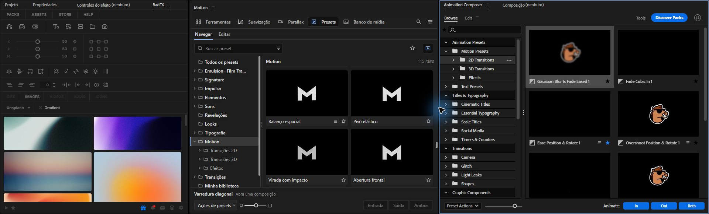
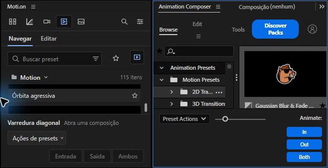
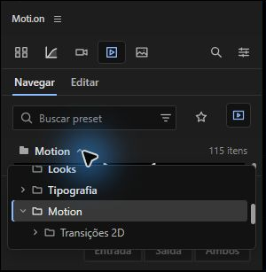
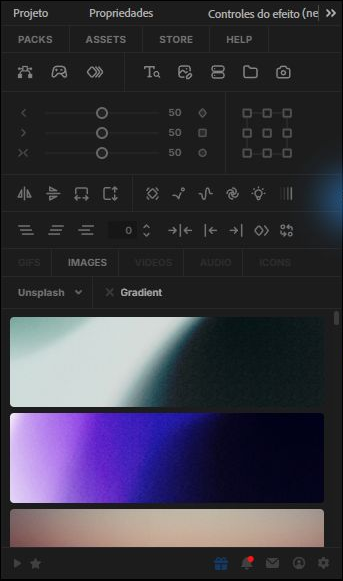

# Moti.on no After Effects — auditoria visual e plano de correção

**Data:** 13/11/2026  
**Última atualização:** 16/11/2026  
**Escopo:** Presets, Banco de mídia, navegação, botões, sliders, menus e editores ao redimensionar o painel no Windows.  
**Entrega:** diagnóstico, plano e correções instaladas no After Effects. Os testes e limites de cada entrega estão registrados abaixo.

O trabalho seguinte, sobre descoberta em Presets e acesso rápido por contexto, está no [registro da paleta e das prévias](2026-11-16-moti-on-presets-e-paleta-contextual.md).

### Etapa 1 · Rodapé implementado

O slider fica diretamente no rodapé, inclusive no compacto. Até 439 px, Ações de presets usa o botão de reticências para liberar largura. Entrada, Saída e Ambos ficam em um grupo horizontal, com a mensagem de contexto acima. Ao aplicar, o estado passa pelo resumo sem deslocar os botões. Se o encaixe do AE ficar abaixo de 280 px de largura, o slider ganha uma linha acima do grupo de fases. [Encaixe extremo no host](2026-11-13-moti-on-layout-evidencias/rodape-encaixe-extremo.png)

No After Effects 26.5x89, o rodapé foi observado em painel encaixado de aproximadamente 280 × 305 px e flutuante de 283 × 336 px externos. Arrastar o slider e usar Home/End alternou entre uma e duas colunas. Os três botões foram exercitados em uma camada descartável e cada aplicação foi revertida em um Undo. O botão Ambos também foi retestado após recarregar o ajuste de estado do rodapé. [Captura encaixada](2026-11-13-moti-on-layout-evidencias/rodape-280x305.png) · [Captura flutuante](2026-11-13-moti-on-layout-evidencias/rodape-flutuante-283x336.jpeg)

O teste focado de navegador passou por 15 amostras de largura com 280 px de altura e verificou área clicável, ordem, colisão, ajuste por teclado e acesso ao menu.

### Etapa 2 · Menus de pastas e filtros

O seletor de pastas usa o espaço acima do rodapé. Quando não cabem três linhas úteis abaixo do seletor, a lista ocupa o corpo da galeria e mantém **Voltar aos presets** visível durante a rolagem. O filtro de etiquetas e as opções individuais das pastas também respeitam o limite superior do rodapé. Escape devolve o foco ao controle que abriu o menu.

No After Effects 26.5x89 no Windows, o painel encaixado foi testado em aproximadamente **320 × 307 px**, **320 × 285 px** e **210 × 285 px**, com as alturas medidas nas capturas incluindo a aba do painel. O teste chegou ao último item com End, voltou à mesma pasta pelo botão Voltar, abriu as opções de uma pasta e acionou Ações de presets diretamente com o filtro aberto. [Pastas](2026-11-13-moti-on-layout-evidencias/menus-pastas-320x307.png) · [Filtro](2026-11-13-moti-on-layout-evidencias/menus-filtro-320x307.png) · [Opções da pasta](2026-11-13-moti-on-layout-evidencias/menus-opcoes-pasta-320x285.png) · [Filtro em altura menor](2026-11-13-moti-on-layout-evidencias/menus-filtro-320x285.png) · [Pastas a 210 × 285 px](2026-11-13-moti-on-layout-evidencias/menus-pastas-210x285.png) · [Filtro a 210 × 285 px](2026-11-13-moti-on-layout-evidencias/menus-filtro-210x285.png)

O primeiro teste de navegador passou em 25 verificações, incluindo cinco combinações de painel baixo e redimensionamento com menu aberto. Os 105 testes focados passaram. Na checagem geral daquela versão, passaram 3.081 de 3.082 testes. O teste de remoção de uma credencial de teste do Windows falhou na suíte e passou na reexecução isolada.

Em 16/11, a gaveta **Variações** passou a ocupar a área da galeria quando a altura não comporta o popover sob o card. No menor encaixe, o botão de fechar fica ao lado da lista rolável, e o slider e as ações continuam acessíveis no rodapé. Ao voltar a uma altura maior, a gaveta retorna ao card com a direção escolhida. No After Effects 26.5 para Windows, foi possível rolar até **De cima**, selecionar essa direção em **Arco coreografado** com o painel de aproximadamente **210 × 286 px** e observar a seleção mantida ao ampliar a altura.

As **27 verificações de Presets no navegador** passaram. O card de referência já permanecia visível ao trocar a densidade e redimensionar entre 720 e 280 px, e esse comportamento foi coberto pelo teste de regressão. Também foram conferidos o foco ao redimensionar a gaveta, o retorno ao botão por Escape e o espaço para uma linha completa na lista a 210 × 250 px CSS. A âncora da grade e o retorno de foco por Escape foram verificados no navegador. [Variações a 210 × 250 px CSS no Chromium](2026-11-13-moti-on-layout-evidencias/etapa2-variacoes-210x250.png)

### Etapa 3 · Banco de mídia

A faixa de tipos, o seletor de fonte e o campo de busca ficam acima da área de rolagem. A grade de Imagens usa uma coluna até 339 px, e abre mais colunas conforme a largura disponível. Redimensionar preserva a consulta, a fonte e a seleção. A paginação acrescenta itens à grade sem recriá-la. Em painéis com menos de 240 px, a aba de efeitos sonoros aparece como **Sons** e o aviso do rodapé ganha uma linha inteira.

**Detalhes** abre uma ficha rolável com prévia, crédito e licença. **Voltar aos resultados** e Escape retornam à mesma seleção. **Importar** fica no rodapé com o motivo do bloqueio ou o andamento da operação. A busca descarta respostas atrasadas e a importação bloqueia disparos repetidos enquanto prepara o arquivo.

| Verificação no After Effects 26.5x89 para Windows | Resultado |
| --- | --- |
| Imagens com a busca `gradient`, seleção e redimensionamento | **PASS** em encaixes de aproximadamente 210 × 280, 280 × 280 e 500 × 280 px, incluindo a aba do host. A grade passou de uma para três colunas. [210 px](2026-11-13-moti-on-layout-evidencias/midia-grade-210x280.png) · [280 px](2026-11-13-moti-on-layout-evidencias/midia-grade-280x280.png) · [500 px](2026-11-13-moti-on-layout-evidencias/midia-grade-500x280.png) |
| Rolagem, paginação, ficha e licença | **PASS** com catálogo de teste. A barra de busca e o rodapé permaneceram acessíveis. [Detalhes a 210 px](2026-11-13-moti-on-layout-evidencias/midia-detalhes-210x280.png) |
| Importar PNG e desfazer | **PASS** com PNG gerado localmente e pré-carregado no cache com checksum. O botão importou a camada no tempo `00:00:01:15`. Um Undo removeu a camada e preservou o tempo. [Importação](2026-11-13-moti-on-layout-evidencias/midia-importada-after-effects.png) · [Undo](2026-11-13-moti-on-layout-evidencias/midia-importacao-undo.png) |
| Instalação principal sem sessão | **PASS**. A aba Imagens mostra **Abrir conta** e mantém **Importar** desabilitado. [Estado sem sessão](2026-11-13-moti-on-layout-evidencias/midia-sem-sessao-final.png) |
| Provedores online, transferência e cancelamento no host | **NOT RUN**. A conta do Banco de mídia estava desconectada. O catálogo local foi usado em uma cópia de teste, restaurada ao concluir. |

O teste de navegador com o bundle instalado passou em seis combinações de 196 × 260 a 720 × 480 px CSS. Ele verificou largura do campo, colunas, seleção preservada, área clicável de Importar, troca de fonte, progresso durante o redimensionamento e cancelamento com download simulado. Os 27 testes focados passaram, e `npm run check` passou com 3.083 testes na versão instalada. No teste nativo a 210 px, a aba foi aberta com o painel mais largo antes de reduzir, pois a navegação global ficou apertada nessa largura.

### Etapa 4 · Botões, espaçamentos e barras de ação

As barras de ação seguem os mesmos tamanhos e espaçamentos do tema do AE. A ação principal fica à direita e o motivo de indisponibilidade aparece junto dela. Quando ações secundárias excedem a largura disponível, **Mais ações** as reúne em um menu rolável. Ao redimensionar, o menu reposiciona ou devolve o foco a um controle visível. Abaixo de 240 px, a navegação usa alvos de 24 px para manter as cinco abas, a busca e as Configurações acessíveis.

| Tela | Validação no After Effects 26.5 para Windows em 15/11/2026 |
| --- | --- |
| Ferramentas | **PASS** no encaixe de aproximadamente 280 × 280 px. A lista de categorias rolou até **Vetor e projeto** com End e respeitou o limite das Ações rápidas. Escape fechou o menu. |
| Suavização | **PASS** entre aproximadamente 210 × 280 e 280 × 280 px. A seção **Ações de keyframes** abriu e fechou sob demanda. **Aplicar** continuou no rodapé e mudou dois keyframes de opacidade em uma camada descartável. Um Undo restaurou a interpolação original. |
| Parallax | **PASS** para layout em aproximadamente 210 × 280 e 280 × 280 px. A abertura de **Ajustes** manteve **Aplicar coreografia** visível, com o motivo de indisponibilidade separado do botão. A execução de um rig de câmera nesta rodada ficou **NOT RUN**. |
| Presets → Editar | **PASS** para a orientação sem composição, retorno por **Ver presets** e edição de uma fase aplicada. A duração de **Arco coreografado** mudou de 38 para 42 frames e o número e o slider permaneceram acessíveis a cerca de 210 × 280 px. Um Undo restaurou 38 frames. |
| Configurações e busca global | **PASS** em aproximadamente 210 × 280 px. O seletor de tema mostrou o rótulo completo, Escape fechou o menu e Banco de mídia abriu pelo próprio ícone após fechar a paleta. A troca de tema foi exercitada no navegador. |

A composição descartável foi removida via Undo. As medidas nativas são aproximadas e incluem a aba do After Effects. O teste de navegador cobriu 33 casos em seis tamanhos de 196 × 260 a 720 × 320 px CSS, incluindo alvos clicáveis, navegação por teclado, presença da ação principal, opções de tema e estados com e sem composição. Os 139 testes focados e as 25 verificações de regressão dos menus de Presets passaram. O `npm run check` da versão instalada passou com 3.084 testes. [Ferramentas no Chromium](2026-11-13-moti-on-layout-evidencias/etapa4-ferramentas-210x280.png) · [Suavização no Chromium](2026-11-13-moti-on-layout-evidencias/etapa4-suavizacao-210x280.png) · [Parallax no Chromium](2026-11-13-moti-on-layout-evidencias/etapa4-parallax-210x280.png) · [Editar no Chromium](2026-11-13-moti-on-layout-evidencias/etapa4-editar-210x280.png) · [Configurações no Chromium](2026-11-13-moti-on-layout-evidencias/etapa4-configuracoes-210x280.png)

### Validação final da matriz

As quatro etapas de implementação foram entregues. O aceite final no After Effects continua aberto nos itens da tabela abaixo.

#### Versão instalada em 16/11/2026

O cliente e o CSS foram atualizados na extensão CEP do Moti.on e o painel foi fechado e reaberto no After Effects 26.5 para Windows. Os três arquivos abaixo conferem com a distribuição local `dist/after-effects-cep`.

| Arquivo na extensão CEP | SHA-256 |
| --- | --- |
| `client/main.js` | `C4B51C6112AE3151C3D106A11184FD6409855A6065294C9A958E70F15E3FFD6B` |
| `styles/theme.css` | `8AC8E47EE5CDB6A1411BA36DD86DFE491CF2A99F2CB121B64554CC34C11A9653` |
| `host/index.jsx` | `899DD6229B659AB2F204B3D3128C5627F18337345E28194BB7F3CEB5356BE7CD` |

| Checagem da versão instalada | Resultado |
| --- | --- |
| `npm run check` | **PASS**. 3.084 de 3.084 testes. |
| Testes focados de interface de Presets e Banco de mídia | **PASS**. 142 de 142 testes. [Galeria](../../apps/after-effects-cep/tests/preset-gallery-ui.test.mjs) · [Navegar e Editar](../../apps/after-effects-cep/tests/preset-workspace-ui.test.mjs) · [Banco de mídia](../../apps/after-effects-cep/tests/stock-library-ui.test.mjs) |
| Presets no navegador | **PASS**. 27 verificações de rodapé, menus, gaveta, foco e posição da grade. [Teste de Presets](../../apps/after-effects-cep/tests/preset-folder-picker.browser.mjs) |
| Barras de ação no navegador | **PASS**. 33 verificações entre 196 × 260 e 720 × 320 px CSS. [Teste das abas](../../apps/after-effects-cep/tests/compact-actions.browser.mjs) |
| Auditoria de layout no navegador | **PASS**. 40 amostras de Ferramentas, Suavização, Parallax, Presets e Banco de mídia a 280, 360, 480 e 720 px de largura, com alturas de 280 e 580 px CSS. Todas dentro da tolerância de 1 px de rolagem horizontal, com as ações medidas visíveis. Os botões Entrada, Saída e Ambos foram medidos pelo teste de Presets. [Script da auditoria](../../scripts/panel-layout-audit.mjs) |

#### Aceite pendente no After Effects

| Frente | Evidência atual | Próxima verificação |
| --- | --- | --- |
| Presets · posição da grade | **PASS** no navegador. **NOT RUN** no host para a âncora. | Rolar até um card de referência, mudar o tamanho das miniaturas e estreitar e ampliar o painel. Conferir se o mesmo card ou um vizinho imediato permanece visível e se a seleção foi preservada. |
| Presets · gaveta Variações | **PASS** no host para rolar, selecionar uma direção em ~210 × 286 px e manter a escolha ao aumentar a altura. **PASS** no navegador para Escape e retorno de foco. | Repetir Escape e validar o foco no botão de Variações no AE. |
| Doca, janela flutuante e aparência | **PASS** nos cenários encaixados registrados nas etapas. Rodapé observado em janela flutuante na etapa 1. | Rodar os tamanhos restantes da matriz, incluindo janela flutuante, escalas de tela, temas e idiomas PT-BR e EN. |
| Teclado e redimensionamento | Grupos de teclas já exercitados nos testes das etapas. **NOT RUN** para o percurso completo e a medição de desempenho no host. | Percorrer as ações com Tab, Shift+Tab, setas, Enter e Escape. Registrar o comportamento durante arraste rápido e após o painel assentar. |
| Parallax · execução do rig | **PASS** para o layout e **Ajustes**. **NOT RUN** para execução do rig nesta versão. | Aplicar a coreografia em composição descartável. Conferir o rig e desfazer a aplicação. |
| Banco de mídia · fluxo online | **PASS** para importação e Undo com PNG local em cópia de teste. **NOT RUN** para o fluxo online no host com a conta desconectada. | Com sessão ativa, confirmar busca, seleção, transferência, progresso durante o redimensionamento, cancelamento quando suportado e importação. |

## 1. Ordem de execução

| Prioridade | Problema | Resultado esperado |
| --- | --- | --- |
| P0 | O slider da galeria some no compacto. O rodapé quebra em linhas com espaço ocioso. | Tamanho das miniaturas ajustável dentro de Navegar em todas as larguras suportadas. Ações de aplicação agrupadas e legíveis. |
| P0 | Em altura baixa, o menu de pastas e o filtro invadem o rodapé. A área da galeria pode ficar reduzida a uma faixa. | Menus com limite e rolagem próprios. Em altura insuficiente, navegação recuperável e instrução de redimensionamento junto do recurso afetado. |
| P1 | A troca entre árvore, seletor e número de colunas muda os itens visíveis no topo. | Preservar o item de referência da rolagem, a seleção e os ajustes enquanto a grade se reorganiza. |
| P1 | Banco de mídia precisa de um fluxo compacto de busca, seleção, detalhes e importação. | Busca prioritária, grade que reflui com a largura, detalhes sob demanda e Importar no alcance do usuário. |
| P2 | Ferramentas, Suavização, Parallax, Editar e Configurações têm necessidades diferentes em altura baixa. | Um sistema comum de espaçamento, foco e barras de ação, com composição adequada a cada tela. |

## 2. Como a comparação foi feita

After Effects 2026 **26.5** no PC do usuário, em Windows, com Moti.on, Animation Composer e BadFX instalados. A bancada começou com os três painéis encaixados. Arrastei os divisores de largura e altura separadamente, mantive a mesma categoria ou busca quando possível, abri menus e alterei o tamanho das prévias. Também capturei o Moti.on desencaixado. Reencaixei o painel e recoloquei as divisões ao fim, deixando as referências abertas.

As dimensões das capturas são medidas aproximadas em pixels da imagem. Nos recortes do host, a altura inclui a aba do After Effects. O painel flutuante tem também a moldura do Windows. A matriz de implementação usa o tamanho útil do painel em **px CSS**, medido no cliente. Registre as duas medidas ao reproduzir um caso em HiDPI.

A comparação com os produtos de referência usou a interface instalada e as páginas públicas dos fabricantes. A leitura de código foi restrita ao Moti.on. A bancada estava sem composição e sem camada selecionada. No Banco de mídia do Moti.on, a sessão estava desconectada. Versões exatas dos dois painéis de referência e escala de tela ficaram sem registro. O comportamento flutuante foi observado em um tamanho; a tentativa de ampliar a janela por automação não alterou as dimensões.

*A01 — BadFX em Imagens com resultados, Moti.on em Motion e Composer em 2D Transitions.*

## 3. Presets — evidência e diagnóstico

### 3.1 Prints enviados

| Captura | O que aparece |
| --- | --- |
| [U01 · 367 × 573](2026-11-13-moti-on-layout-evidencias/u01-moti-367.png) | Árvore fixa com largura próxima à metade do painel. Uma coluna de cards. Slider visível ao lado de Ações de presets. Entrada, Saída e Ambos ocupam a linha abaixo. Nomes de pastas e cards truncados. |
| [U02 · 298 × 579](2026-11-13-moti-on-layout-evidencias/u02-moti-298.png) | A árvore vira o seletor Motion e o card ganha largura. Slider ausente. Ações de presets fica sozinho à esquerda, com os três botões na linha inferior. |
| [U03 · 388 × 574](2026-11-13-moti-on-layout-evidencias/u03-moti-388.png) | Slider e árvore visíveis. Rodapé ainda em várias linhas. O texto “Abra uma composição” indica o motivo de os botões estarem desabilitados nas três capturas. |

### 3.2 Comportamento reproduzido no PC

| Medida aproximada do painel | Moti.on | Animation Composer |
| --- | --- | --- |
| Largo, Moti.on ~674 × 580 e Composer ~730 × 580 | Árvore, duas colunas na densidade corrente, resumo e rodapé fixo. Ações, slider e botões de fase na mesma linha de controles. | Árvore com divisor, grade com duas colunas na densidade corrente. Após selecionar um item, Ações, slider e In / Out / Both ficam na mesma linha. [A02](2026-11-13-moti-on-layout-evidencias/a02-presets-largos.png) |
| Estreito e alto, Moti.on ~300 × 580 e Composer ~347 × 580 | Seletor de pasta, galeria de uma coluna, slider ausente. Ações e grupo de fases em linhas distintas. | Slider permanece; In / Out / Both passam a três linhas à direita. Árvore fixa e cards apertados. O divisor cede espaço à galeria e reduz o espaço dos nomes. [A04](2026-11-13-moti-on-layout-evidencias/a04-presets-estreitos-altos.png) · [A26–A28](#índice-de-capturas) |
| Estreito e baixo, Moti.on ~300 × 335 e Composer ~347 × 335 | Slider continua ausente. Cabeçalho e rodapé deixam cerca de 60 px visíveis para os cards nessa posição de rolagem. | Slider e fases continuam visíveis, com menos espaço para navegar nos cards e na árvore. [A03](2026-11-13-moti-on-layout-evidencias/a03-presets-estreitos-baixos.png) |
| Moti.on ~300 × 307, menus abertos | Pastas cobre o resumo e parte da área de ações. Filtro também se estende sobre o rodapé. [A29](2026-11-13-moti-on-layout-evidencias/a29-moti-pastas-sobre-rodape.png) · [A30](2026-11-13-moti-on-layout-evidencias/a30-moti-filtro-sobre-rodape.png) | O Composer estava largo nesta tomada. |
| Moti.on flutuante ~296 × 381 externo | Seletor compacto, slider ausente e rodapé em várias linhas. [A16](2026-11-13-moti-on-layout-evidencias/a16-moti-flutuante.png) | Fora da amostra flutuante. |

O slider do Moti.on é **Tamanho das miniaturas**. Em ~455 px de largura, arrastá-lo para a esquerda passou a galeria de uma para duas colunas no mesmo encaixe. Em ~280 e ~335 px ele sumiu. Em ~347 px voltou, ainda com seletor de pastas. Os parâmetros de duração e curva pertencem aos editores dos presets e ferramentas. Configurações → Prévias também exibe o ajuste de tamanho. [A05–A07, A17–A20](#índice-de-capturas)

Nos prints estáveis, os retângulos de Entrada, Saída e Ambos ficaram separados. A quebra em duas linhas com desalinhamento reproduziu a queixa de posicionamento. A sobreposição comprovada foi a dos menus em altura baixa. Durante um arraste rápido, uma captura pegou a grade temporariamente vazia e elementos ainda se reposicionando. A captura seguinte mostrou o layout assentado. O teste de regressão precisa verificar a transição e o estado final. [A31](2026-11-13-moti-on-layout-evidencias/a31-moti-redimensionamento-transitorio.png)

### 3.3 Causas e pontos de trabalho no Moti.on

| Ponto | Evidência no checkout | Consequência para a implementação |
| --- | --- | --- |
| Slider escondido | [ae-design-system.css, linhas 428–452](../../packages/ui-core/src/ae-design-system.css#L428) usa `flex-wrap`, resumo em linha própria, blocos rígidos e `display:none` no controle até 339 px. [scripts/build.mjs](../../scripts/build.mjs#L149) coloca essa folha no fim do tema do AE. | Substituir a regra por composição deliberada do rodapé. Conferir o CSS computado do build, inclusive overrides de `preset-approved.css` e `ae-workstation.css`. |
| Duas entradas para a mesma preferência | [preset-gallery.ts](../../apps/after-effects-cep/client/src/preset-gallery.ts#L875) cria o range de 140–320 px, passo 20. [settings-view.ts](../../apps/after-effects-cep/client/src/views/settings-view.ts#L52) expõe o mesmo `presetSize` com passo 10. [panel-preferences.ts](../../packages/ui-core/src/panel-preferences.ts#L170) aceita o valor no intervalo. | Usar a mesma fonte de verdade e unificar o passo. Proposta de 10 px para representar valores já gravados por Configurações, como 230 px. |
| Árvore e folha compacta | [preset-folder-picker.ts](../../apps/after-effects-cep/client/src/preset-folder-picker.ts#L12) usa 360 px para a árvore e força uma altura mínima de 96 px para o menu. A função `place` toma o maior valor entre esse mínimo e a área calculada. | Em painel baixo, o mínimo pode superar o espaço disponível, compatível com A29. Medir o retângulo disponível e oferecer outra apresentação quando a lista perder altura útil. O filtro de etiquetas tem posicionamento próprio e precisa da mesma validação geométrica. |
| Refluxo e contexto | [preset-gallery.ts](../../apps/after-effects-cep/client/src/preset-gallery.ts#L1245) recalcula seletor, divisor, dimensões e posição dos ajustes no resize. Nas capturas, o item de topo muda quando a grade troca de colunas. | Instrumentar ID/offset do card, número de colunas e tempo até estabilizar. Verificar se há salto de referência antes de alterar a restauração existente. |

## 4. O que aproveitar de cada referência

| Aspecto | Padrão observado | Decisão proposta para o Moti.on |
| --- | --- | --- |
| Controles de Presets | Composer conserva ações e densidade no rodapé em largura estreita. A pilha de fases preserva acesso, mas custa altura. | Priorizar fases no mesmo grupo horizontal quando couber. Em modo baixo, levar tamanho e ações secundárias para um botão “Opções de presets” com nome acessível. |
| Categorias | O divisor do Composer funciona mesmo no encaixe estreito, com truncamento da árvore e galeria comprimida. O seletor do Moti.on libera a largura inteira abaixo de 360 px. | Aproveitar o seletor que já existe e corrigir o limite vertical. Usar a árvore quando sobra espaço efetivo para pelo menos um card legível. |
| Editar sem contexto | Composer mostra “No layer selected.”. Moti.on mostra Presets, Seleção de camadas, Cores e Ferramentas com mensagens distintas na mesma tela. | Uma mensagem primária de contexto com “Ver presets” quando útil. Exibir grupos dependentes de seleção conforme o contexto habilita os controles. |
| Busca de imagens | BadFX mantém tipos de mídia, fonte e pesquisa na entrada de Assets. Ao abrir Images, aparecem sugestões; ao clicar em Gradient, surgem os resultados de Unsplash. O seletor mostrou também Pexels. | Tipos de mídia sempre localizáveis. Busca com espaço útil. Mostrar fontes habilitadas no Moti.on e oferecer sugestões por tipo quando a consulta estiver vazia. |
| Grade de imagens | A busca Gradient passou de sete colunas em ~1267 px para duas em ~510 px e uma em ~343 px. O recorte largo mostra proporções variadas e ação de link no hover. | Reorganizar por largura útil e preservar seleção. Começar com uma grade simples e foco previsível. Mostrar a proporção original na prévia e deixar crédito e link acessíveis também por teclado. |
| Assets com pouca altura | A barra de ferramentas superior do BadFX continua ocupando espaço. Na tomada baixa de ~343 px de largura, a região abaixo da busca mal aparece. | Dar altura à busca e aos resultados quando Banco de mídia estiver ativo. Manter detalhes atrás de seleção explícita no compacto. |

O changelog do Composer registra correções para In / Out em largura estreita e estabilização da largura das prévias ao aparecer a barra de rolagem. A página oficial do BadFX confirma o escopo de imagens, vídeos, GIFs e sons no painel. A Adobe documenta que os grupos vizinhos mudam junto quando o usuário arrasta um divisor. Esses três pontos fundamentam a matriz de resize e rolagem abaixo. [Changelog do Animation Composer](https://misterhorse.com/changelog/animation-composer-plugin/1) · [BadFX Plugin](https://badedits.com/plugin) · [Painéis e espaços de trabalho do After Effects](https://helpx.adobe.com/after-effects/desktop/get-started/get-familiar-with-the-interface/workspaces-panels-viewers.html)

## 5. Especificação proposta

### 5.1 Largura, altura e densidade

Usar as quatro faixas da fundação do projeto como pontos de QA. A composição do rodapé deve reagir ao espaço que seus grupos ocupam com o idioma e a densidade ativos. A altura deve ser avaliada pelo espaço que resta depois de cabeçalho e rodapé.

| Largura útil | Navegação e galeria | Controles de Presets |
| --- | --- | --- |
| 280–339 px | Ícones de navegação com nome acessível e dica; busca flexível; seletor de pastas; uma coluna como padrão inicial. | Resumo conciso em uma linha. Opções de presets à esquerda; fases à direita, em um grupo compacto. Tamanho das miniaturas disponível dentro de Opções. |
| 340–479 px | Mostrar rótulos onde couber. Manter o seletor abaixo de 360 px; a partir daí, testar se árvore e um card cabem com margem e scrollbar. | Exibir o slider inline quando couber com o grupo de fases. Enquanto faltar espaço, usar a mesma entrada de Opções, sem criar uma linha exclusiva. |
| 480–719 px | Árvore ajustável e grade fluida. Sidebar limitada pela largura mínima da galeria. | Slider inline; Ações de presets identificado; fases agrupadas. |
| ≥720 px | Árvore e grade com mais colunas conforme tamanho escolhido. Ajustes associados ao card ou seleção. | Espaçamento regular; evitar esticar trilho, botões e campos por toda a largura. |

Altura útil **abaixo de 420 px** entra como faixa inicial de teste, coerente com as regras existentes do painel. O limiar real para cada fallback deve ser calculado e confirmado com teclado e texto longo.

- Reservar a área de ações no layout com `auto minmax(0, 1fr) auto` ou estrutura equivalente. A rolagem principal pertence ao conteúdo. Em árvore + grade, cada região pode rolar verticalmente com largura estável.
- Começar com grupos fixos de controle de **28 px** de altura e alvos de pelo menos **24 × 24 px**. Reduzir padding e gaps de 8 para 4 px onde couber. Preservar alvos, texto legível e separação visual de Aplicar, menus e favoritos.
- Em Presets, a primeira linha do rodapé resume item e impedimento quando necessários. Na linha de controles, fases têm prioridade sobre conveniências de visualização. Ações de presets e Opções podem ser o mesmo disparador no compacto, com seções de ações e visualização; usar rótulo acessível completo. Reter Entrada, Saída e Ambos lado a lado quando couberem. Se o grupo não couber com o disparador, oferecer “Aplicar ▾” com as fases explicitamente rotuladas. Nenhuma direção deve ser aplicada só ao abrir o menu.
- O ajuste de tamanho usa o mesmo valor em Configurações e em Navegar. Mostrar o valor em px no menu, oferecer setas e Home/End e manter o foco quando o painel muda de faixa. A compactação automática pode limitar o tamanho efetivo sem gravar por cima da preferência. Ao ampliar, reaplicar a preferência.
- Em altura crítica, trocar miniaturas grandes por uma lista compacta com título e acesso à prévia, se a lista couber. Preservar busca, seleção e a ação principal. Se o gráfico, prévia ou editor exigir mais espaço, usar aviso local como **“Aumente a altura do painel para ver a prévia.”** Se o impedimento for largura, dizer largura. Em espaço suficiente, o aviso desaparece. Evitar mostrar aviso quando um menu compacto já resolve o acesso.
- Em menus de pastas, filtros e ações, medir espaço acima e abaixo da âncora, descontando a área reservada para ações. Se nenhuma direção comportar uma lista útil, usar uma vista de seleção dentro do corpo, com **Voltar** visível e rolagem própria. Conter o foco na superfície modal quando houver uma; Escape fecha e devolve o foco ao disparador ainda visível. Em compactação durante uma edição, transportar o rascunho e o foco para o controle equivalente.
- Reservar trilho da barra de rolagem e largura dos ícones do card para evitar que a estrela e o menu empurrem o título. Usar `min-width:0` nas zonas de texto e título completo acessível. Definir proporção 16:9 para prévias de presets e manter espaço da imagem durante o carregamento.
- Agrupar cálculo do resize por frame e atualizar modos discretos apenas quando mudarem. Evitar animar a geometria enquanto a divisória estiver sendo arrastada. Usar as classes de largura e observadores existentes, com CSS compatível com o Chromium do CEP alvo documentado no projeto.

### 5.2 Banco de mídia — Imagens primeiro

O Moti.on já mostra abas Vídeos / Imagens / Efeitos sonoros. No PC, Imagens exibiu “Entre com sua conta para usar o Banco de mídia.” e Importar desabilitado. Essa captura serve para validar a entrada sem sessão. O código próprio já contém seletor de fontes, busca, sugestões, cards, detalhes, crédito, paginação e fluxo de importação. [A25](2026-11-13-moti-on-layout-evidencias/a25-moti-midia-sem-sessao.png) · [stock-library.ts](../../apps/after-effects-cep/client/src/stock-library.ts#L49)

1. **Entrada.** No estado sem sessão, oferecer “Entrar” junto do texto, apontando para o fluxo existente de conta se ele estiver disponível. Após autenticar, voltar para a aba que estava ativa. Mostrar motivo específico para provedor indisponível, falta de rede ou falha recuperável, com ação compatível.
2. **Busca.** Em ~280–339 px, manter tipo ativo e busca legível; recolher fontes num seletor de nome curto quando o texto apertar o campo. Se a linha não couber, mover a fonte para um filtro acessível. Manter consulta e fonte enquanto o painel redimensiona. Usar sugestões em linhas flexíveis quando a busca estiver vazia.
3. **Resultados.** Começar com uma coluna em modo estreito e aumentar conforme a largura útil permite cards com boa leitura. Medir ~140–160 px como ponto de partida para a largura mínima de um card de imagem. Travar o espaço da miniatura durante carregamento; selecionar sem deslocar o grid; respeitar a proporção original na visualização de detalhes. Separar aparência de imagem, vídeo e áudio com os componentes já disponíveis para cada tipo.
4. **Detalhes e importação.** Em compacto, mostrar título, crédito e fonte em uma folha rolável após selecionar. Em painel amplo, testar detalhe lateral só se a grade ainda tiver área útil. Deixar Importar e, durante download, Cancelar quando suportado em uma área estável. Mostrar progresso junto da ação. Verificar clique, duplo clique existente e teclado para impedir disparo duplicado. Um redimensionamento em andamento deve manter seleção, consulta, páginas, download e progresso.
5. **Estados para QA.** Sem sessão, carregando fontes, busca vazia com sugestões, busca em progresso, zero resultados, erro e nova tentativa, resultados paginados, item selecionado, download, cancelamento, importação e falha. Testar primeiro com respostas controladas e depois com a integração real e uma composição descartável.

### 5.3 Outras superfícies

| Tela | Observado no PC | Ajuste e critério |
| --- | --- | --- |
| Presets → Editar | Estado vazio longo em ~296 px, com mensagens em várias seções. [A09–A10](#índice-de-capturas) | Contexto consolidado; com seleção válida, grupos de parâmetros refluem para uma coluna. Campo numérico e unidade acessíveis mesmo quando o slider muda de linha. |
| Ferramentas | Grade de quatro tiles em ~296 px e Ações rápidas ao pé. [A11](2026-11-13-moti-on-layout-evidencias/a11-ferramentas.png) | Confirmar botões e menus por teclado e mouse na altura baixa. Respeitar o recolhimento existente das Ações rápidas. Validar acesso a ajustes com rótulos longos e escala maior. |
| Suavização | Em ~296 × 333, os grupos de atalhos vêm antes da curva. Só parte da curva aparece antes de rolar. A rolagem revela sliders Entrada/Saída, valores e unidade; Redefinir / Aplicar ficam visíveis. [A12–A13](#índice-de-capturas) | Dar prioridade à curva e aos valores principais. Recolher grupos auxiliares em altura baixa. Se o gráfico perder área para manipular os pontos, oferecer edição numérica e aviso local. Testar arraste, valores e aplicação com seleção válida. |
| Parallax | Dois cards por linha em ~296 px, títulos longos truncados, Aplicar coreografia visível e desabilitado no estado capturado. [A14](2026-11-13-moti-on-layout-evidencias/a14-parallax.png) | Título completo acessível, uma coluna se o card perder legibilidade, ação e impedimento visíveis, ajustes avançados na região rolável. |
| Configurações e busca global | Configurações conserva rolagem em painel baixo; o ajuste de tamanho aparece após rolar. Busca global ainda precisa de teste de menu e foco nessa altura. [A15](2026-11-13-moti-on-layout-evidencias/a15-configuracoes.png) | Verificar selects, atalhos, temas e menus em 280 × 280. Trazer foco de volta após fechar popover e manter valores sincronizados com as respectivas telas. |

## 6. Etapas de implementação

| Etapa | Trabalho | Como encerrar |
| --- | --- | --- |
| 0 · Linha de base | Registrar identificação do build instalado e viewport CSS, congelar as capturas de 298 × 579 e ~300 × 307 como repro, criar composição descartável com shape/texto e presets nas fases de entrada/saída. Preparar resposta controlada do Banco de mídia para o layout. | Mapa antes/depois com o mesmo conteúdo e medidas. Em caso de divergência entre fonte e build instalado, identificar qual versão contém o comportamento antes de editar. |
| 1 · Rodapé de Presets | Ajustar `preset-gallery.ts` e regras de layout efetivas em `ae-design-system.css`. Reusar barra, botões e preferências. Trazer o tamanho das miniaturas para Opções quando necessário. Alinhar as fases e organizar o resumo. | Ajustar tamanho na galeria em 280 px; 0 colisões; todas as fases válidas acionáveis uma vez. Estado sem composição continua informativo. |
| 2 · Menus e galeria baixa | Corrigir limites do seletor em `preset-folder-picker.ts`, filtro e gaveta. Conter overlays e garantir acesso a prévia/seleção/rolagem. Validar âncora da grade ao trocar densidade. | Repetir A29 e A30 com o rodapé íntegro. Redimensionar com menu aberto e card selecionado; seleção, busca, pasta, valores e foco seguem utilizáveis. |
| 3 · Banco de mídia | Ajustar renderização da view em `main.ts`, apresentação em `stock-library.ts` e estilos AE. Implementar a composição compacta de busca, grade, detalhes e rodapé. | Repetir a mesma busca com 280, 360, 480 e 720 px, selecionar o mesmo item após reflow e concluir uma importação em fixture real. |
| 4 · Sistema e telas restantes | Reusar tokens do tema AE para alvos, gaps, foco e avisos. Aplicar os padrões às telas da seção 5.3 onde a matriz acusar falha. | Capturas em tamanhos e temas previstos, com a ação principal visível e a edição de parâmetros completa. |

As etapas são entregas revisáveis. Manter cada mudança visual em um commit isolado permite reverter o layout de uma tela sem mexer em dados do usuário. Dimensionamento deve permanecer no cliente AE, com os contratos existentes de aplicação, timing, seleção, editabilidade e Undo. Preservar os IDs das preferências e os valores persistidos. Os padrões de aparência e comportamento vêm da [fundação visual do Moti.on](../UI_FOUNDATION.md).

## 7. Matriz e critérios de aceite

| Matriz | Executar e registrar |
| --- | --- |
| Larguras | 280, 298, 339, 340, 359, 360, 388, 479, 480, 719 e 720 px CSS. Usar também 367 px para repetir U01 e uma largura ≥900 para a grade ampla. |
| Alturas | 280, 305, 335, 419, 420 e 580 px; incluir um painel alto para a comparação visual. Casos centrais em 280 × 280, 298 × 305, 298 × 579, 360 × 335, 480 × 420 e 720 × 580. |
| Host | AE Windows encaixado e flutuante, redimensionando largura, altura e os dois eixos. Validar escala de tela em 100%, 125% e 150%, com 200% se disponível; temas escuro e claro/automático e strings PT-BR / EN. |
| Interação | Mouse e Tab / Shift+Tab / setas / Enter / Escape; menus abertos e fechados; nomes longos; um ou vários resultados; com e sem composição; seleção válida e inválida; resize durante arraste do slider e durante download de teste. |
| Projeto descartável | Aplicar Entrada, Saída e Ambos em camadas compatíveis. Verificar seleção, timing, editabilidade e um Undo por aplicação. Abrir Editar e ajustar valores, redimensionar e confirmar que o rascunho e o preset ativo persistem. Importar uma imagem em projeto de teste e verificar o item e o crédito. |

- **Geometria:** zero interseções entre alvos adjacentes e zero scroll horizontal na raiz, com tolerância de 1 px para arredondamento. A área clicável e o anel de foco dos controles visíveis ficam dentro do viewport. Em navegador, medir retângulos e testar o elemento atingido por clique, inclusive sob overlays. Repetir visualmente no CEP.
- **Altura:** a barra de ações fica acessível sem rolar a galeria. Se o conteúdo restante não comportar uma prévia útil, lista compacta ou aviso local oferece o caminho seguinte. A última linha de uma lista e a última opção de um menu são alcançáveis por rolagem e teclado.
- **Estado:** reduzir e voltar à largura inicial conserva pasta, consulta, filtros, favorito, preset selecionado, densidade e rascunho. A grade tenta manter o card-âncora ou vizinho imediato visível ao mudar colunas. Barra de rolagem e estados de carregamento não provocam oscilação de colunas.
- **Ações:** controles recebem foco em ordem visual, apresentam nome e estado legíveis e disparam a operação uma vez. Um controle com impedimento de contexto oferece motivo distinto de uma limitação de espaço. Durante resize, nenhum clique implícito aplica preset ou inicia importação.
- **Evidência:** reutilizar [panel-layout-audit.mjs](../../scripts/panel-layout-audit.mjs) e os testes de [galeria](../../apps/after-effects-cep/tests/preset-gallery-ui.test.mjs), [seletor de pastas](../../apps/after-effects-cep/tests/preset-folder-picker.browser.mjs), [preferências](../../packages/ui-core/tests/preset-preferences.test.mjs) e [Banco de mídia](../../apps/after-effects-cep/tests/stock-library-ui.test.mjs). O script atual amostra uma altura por execução e mede overflow e visibilidade do primário. Incluir as alturas críticas e a colisão entre elementos, além de conferir os seletores da barra de fases. Rodar `npm run check` e guardar a matriz nativa com PASS / FAIL / NOT RUN a cada etapa.

| Linha de base de 13/11/2026 | Resultado observado na auditoria inicial |
| --- | --- |
| Presets no host, slider e resize encaixado | Observado. Falhas reproduzidas de acesso ao slider e sobreposição de menus. |
| Presets no host, painel flutuante | Observado em ~296 × 381 externo. Variação de tamanhos flutuantes pendente. |
| BadFX Images no host | Busca Gradient, seletor de fontes, grade e reflow observados. Importação e detalhes completos não exercitados. |
| Banco de mídia Moti.on | Tela sem sessão observada. Grade com sessão, rede, download e importação no host **NOT RUN**. |
| Presets com camada, aplicação, Undo, ajustes ativos | **NOT RUN**. |
| Escalas de tela, teclado completo, temas e performance de resize | **NOT RUN**. |
| Build, testes automatizados e validação das correções | **NOT RUN** na auditoria inicial. Os resultados das versões instaladas estão na seção Validação final da matriz. |

## Índice de capturas

Os recortes foram feitos das janelas observadas no PC. U01–U03 são os três anexos originais. A05 e A06 mostram a mesma área antes e depois do arraste; A29 e A30 mostram overlays diferentes.

| Captura | Conteúdo |
| --- | --- |
| [A01](2026-11-13-moti-on-layout-evidencias/a01-bancada.png) · [A02](2026-11-13-moti-on-layout-evidencias/a02-presets-largos.png) | Bancada e comparação dos rodapés em largura ampla. |
| [A03](2026-11-13-moti-on-layout-evidencias/a03-presets-estreitos-baixos.png) · [A04](2026-11-13-moti-on-layout-evidencias/a04-presets-estreitos-altos.png) | Mesmas larguras estreitas com duas alturas. |
| [A05](2026-11-13-moti-on-layout-evidencias/a05-miniaturas-antes.png) · [A06](2026-11-13-moti-on-layout-evidencias/a06-miniaturas-depois.png) · [A07](2026-11-13-moti-on-layout-evidencias/a07-miniaturas-configuracoes.png) | Slider na galeria e ajuste em Configurações. |
| [A08](2026-11-13-moti-on-layout-evidencias/a08-menu-pastas.png) · [A09](2026-11-13-moti-on-layout-evidencias/a09-editar-moti.png) · [A10](2026-11-13-moti-on-layout-evidencias/a10-editar-composer.png) | Pastas no modo compacto alto; Editar sem camada nos dois painéis. |
| [A11](2026-11-13-moti-on-layout-evidencias/a11-ferramentas.png) · [A12](2026-11-13-moti-on-layout-evidencias/a12-suavizacao-baixo.png) · [A13](2026-11-13-moti-on-layout-evidencias/a13-suavizacao-rolado.png) | Ferramentas, curva de Suavização e sliders revelados por rolagem. |
| [A14](2026-11-13-moti-on-layout-evidencias/a14-parallax.png) · [A15](2026-11-13-moti-on-layout-evidencias/a15-configuracoes.png) · [A16](2026-11-13-moti-on-layout-evidencias/a16-moti-flutuante.png) | Parallax, Configurações e Moti.on flutuante. |
| [A17](2026-11-13-moti-on-layout-evidencias/a17-moti-280.png) · [A18](2026-11-13-moti-on-layout-evidencias/a18-moti-335.png) · [A19](2026-11-13-moti-on-layout-evidencias/a19-moti-347.png) · [A20](2026-11-13-moti-on-layout-evidencias/a20-moti-360.png) | Quatro larguras de Presets, incluindo a volta do slider antes da volta da árvore. |
| [A21](2026-11-13-moti-on-layout-evidencias/a21-badfx-busca.png) · [A22](2026-11-13-moti-on-layout-evidencias/a22-badfx-fontes.png) · [A23](2026-11-13-moti-on-layout-evidencias/a23-badfx-resultados-largo.png) · [A24](2026-11-13-moti-on-layout-evidencias/a24-badfx-resultados-estreito.png) | BadFX Images: sugestões, fontes, sete colunas e uma coluna. |
| [A25](2026-11-13-moti-on-layout-evidencias/a25-moti-midia-sem-sessao.png) | Banco de mídia do Moti.on em Imagens sem sessão. |
| [A26](2026-11-13-moti-on-layout-evidencias/a26-composer-estreito-antes.png) · [A27](2026-11-13-moti-on-layout-evidencias/a27-composer-estreito-divisor.png) · [A28](2026-11-13-moti-on-layout-evidencias/a28-composer-estreito-slider.png) | Composer estreito, ajuste do divisor e slider. |
| [A29](2026-11-13-moti-on-layout-evidencias/a29-moti-pastas-sobre-rodape.png) · [A30](2026-11-13-moti-on-layout-evidencias/a30-moti-filtro-sobre-rodape.png) · [A31](2026-11-13-moti-on-layout-evidencias/a31-moti-redimensionamento-transitorio.png) | Invasão do rodapé por pastas e filtro; estado transitório imediatamente após resize. |

## Referências

- Documentação e material visual oficiais do Animation Composer para After Effects. [Mister Horse](https://misterhorse.com/animation-composer-for-after-effects)
- Recursos, busca de mídia e tutorial do BadFX para After Effects. [badedits](https://badedits.com/plugin)
- Encaixe, desencaixe e resize dos grupos de painéis. [Adobe](https://helpx.adobe.com/after-effects/desktop/get-started/get-familiar-with-the-interface/workspaces-panels-viewers.html)
