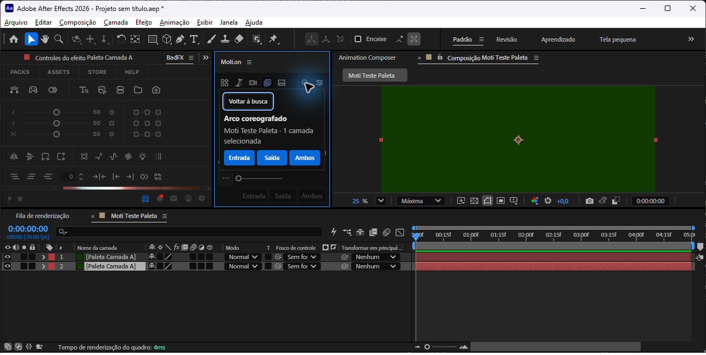
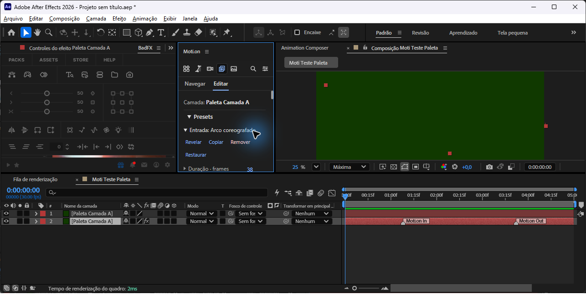
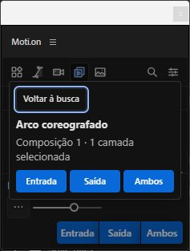

# Moti.on no After Effects — Presets visuais e paleta contextual

**16/11/2026.** Implementação no cliente CEP do Moti.on para After Effects em Windows. A paleta fica dentro do painel e usa os comandos que já servem à galeria e às Ações rápidas. [Auditoria visual e plano responsivo anteriores](2026-11-13-moti-on-plano-layout-responsivo.md)

## Referências visuais

| Referência observada | Decisão no Moti.on |
| --- | --- |
| O Animation Composer organiza pastas e prévias em Navegar e concentra ajustes em Editar. As fases ficam junto da ação de aplicar. [Captura A02 no After Effects](2026-11-13-moti-on-layout-evidencias/a02-presets-largos.png) · [Mister Horse](https://misterhorse.com/animation-composer-for-after-effects) | Árvore com divisor em largura maior, seletor no compacto, fases e slider no rodapé. A aplicação confirmada abre Editar. |
| O BadFX mostra sugestões e reorganiza a grade de mídia. No painel estreito a mesma busca passou para uma coluna. [Captura A24 no After Effects](2026-11-13-moti-on-layout-evidencias/a24-badfx-resultados-estreito.png) · [badedits](https://badedits.com/plugin) | Atalhos para categorias quando a busca de Presets está vazia. A altura disponível define se aparecem acima da grade ou dentro do menu de busca. |
| O Quick Apply reúne efeitos, presets e comandos por busca no próprio After Effects. [Adobe](https://helpx.adobe.com/after-effects/desktop/animate-in-after-effects/animation-keyframes/quick-apply.html) | Busca do Moti.on com a ação indicada no resultado e uma segunda vista para definir a fase e conferir o destino da animação. |

## Interface entregue

### Paleta e contexto

- Abra a lupa ou use `Ctrl+K` com foco no Moti.on. Com a busca vazia, aparecem ações disponíveis para o contexto, recentes e atalhos de navegação. Com consulta, os resultados agrupam Presets, Efeitos, Ferramentas, Ações rápidas, Telas e Ajustes. Uma correspondência exata, como **Desfoque**, precede títulos de presets com o mesmo prefixo.
- `Enter` em um preset de fase abre a vista **Entrada / Saída / Ambos**, com foco inicial em **Voltar à busca**. A vista mostra a composição e o número de camadas selecionadas. A confirmação lê novamente o contexto. Se composição ou seleção mudou, a paleta pede uma nova escolha antes de aplicar. Erro mantém a vista aberta. `Esc` volta à consulta e ao resultado anterior. Outro `Esc` devolve o foco ao disparador.
- `Shift+Enter` abre ajustes ou revela o preset na galeria. Presets com aplicação própria, como transições de câmera, abrem na galeria. A revelação pela paleta posiciona o card. O retorno de Editar à mesma seleção restaura a posição da galeria. Recência de aplicação é gravada depois da confirmação do host.
- **Criar objeto nulo** e **Desfoque** executam pelas Ações rápidas. **Neon** e **Gradientes** abrem seus controles. Suavização, Parallax e Banco de mídia abrem suas telas. Os fluxos de rig, licença e importação seguem nos respectivos editores.

### Navegar, Editar e prévias

- **Tipografia**, **Motion** e **Transições** são atalhos de categoria. Acima de 220 px de altura útil no corpo da galeria, aparecem em uma fila curta quando a busca está vazia. Em altura menor, ficam em **Explorar presets** no menu do campo de busca. Digitar devolve essa altura aos resultados. Pastas, favoritos e rolagem continuam disponíveis na galeria.
- A escolha de fase reutiliza os botões do rodapé. Os três rótulos cabem em uma linha na doca compacta observada. Estados indisponíveis mostram o motivo no seletor. O painel acompanha o tema automático do After Effects e as opções Claro e Escuro do Moti.on.
- **Arco coreografado** usa um losango e um alvo fixo para deixar o deslocamento legível. **Corte inclinado**, na família de linhas, usa o render próprio de duas linhas com uma moldura discreta. **Separação RGB premium** usa uma silhueta gráfica de alto contraste para deixar os canais deslocados visíveis. Os três usam o quadro 16:9 e a reprodução da galeria.

## Capturas

### Antes e depois no navegador

Mesmo preset, consulta, seleção e viewport de **480 × 420 px CSS**. A coluna Antes usa os arquivos da extensão anterior à implementação. A coluna Depois usa a distribuição que passou pelos testes desta rodada.

| Fluxo | Antes | Depois |
| --- | --- | --- |
| Busca global por Arco coreografado | [Paleta sem resultado](2026-11-16-moti-on-paleta-evidencias/antes-paleta-480x420.png) | [Resultado com Escolher fase](2026-11-16-moti-on-paleta-evidencias/depois-paleta-480x420.png) |
| Card e rodapé | [Prévia anterior](2026-11-16-moti-on-paleta-evidencias/antes-presets-480x420.png) | [Forma e referência fixa](2026-11-16-moti-on-paleta-evidencias/depois-presets-480x420.png) |
| Descoberta e outras prévias | | [Atalhos de categoria](2026-11-16-moti-on-paleta-evidencias/depois-descoberta-720x580.png) · [Tipografia](2026-11-16-moti-on-paleta-evidencias/depois-previa-tipografia-720x580.png) · [Separação RGB](2026-11-16-moti-on-paleta-evidencias/depois-previa-rgb-720x580.png) |

### After Effects no Windows

*Doca de aproximadamente 210 × 286 px incluindo a aba do host. Após a leitura, a composição e uma camada selecionada aparecem junto das três fases, antes da aplicação.*

*O comando Ambos aplicou Entrada e Saída à camada de destino. Editar abriu e a timeline mostrou os dois marcadores. Um Undo retirou os dois.*

## Validação

| Cenário | Resultado |
| --- | --- |
| After Effects 26.5 · Arco coreografado | **PASS** em composição descartável de 5 s a 30 fps. Entrada, Saída e Ambos foram confirmados individualmente na doca compacta. Cada aplicação aberta em Editar foi desfeita em um Undo. |
| After Effects 26.5 · Troca de camada e clique repetido | **PASS**. Duas camadas com o mesmo nome permitiram verificar que a troca de seleção exige nova confirmação. O clique duplo após reconfirmar Ambos deixou um par de marcadores e um único Undo os retirou. |
| After Effects 26.5 · Ações rápidas | **PASS**. Criar objeto nulo com composição sem camadas selecionadas. Desfoque na camada descartável. Undo nas duas operações. `Ctrl+K` abriu a paleta com foco no painel e `Shift+Enter` abriu Neon para ajuste. |
| After Effects 26.5 · Layout e foco | **PASS** na doca de cerca de 210 × 286 e 480 × 420 px externos, incluindo redimensionar com fases abertas. Após o ajuste de CSS, os três rótulos ficaram em uma linha a 210 px. Sem composição, as fases mostraram o motivo de indisponibilidade. A aba Editar foi observada em janela flutuante a cerca de 483 × 453 px externos. |
| After Effects 26.5 · Revisão final em janela flutuante | **PASS** para Entrada, Saída e Ambos com um Undo por aplicação, em 231 × 238 px CSS úteis. Consulte o reteste abaixo. |
| After Effects 26.5 · Critérios ainda sem execução | **NOT RUN** para as demais dimensões exatas no host e a matriz nativa de temas, idiomas e movimento reduzido. |
| Navegador · Paleta e descoberta | **PASS** em 210 × 250, 280 × 280, 360 × 335, 480 × 420 e 720 × 580 px CSS, com amostras de Claro, Escuro, Automático, PT-BR, EN e movimento reduzido. Incluiu mudança de camada e composição, erro e reexecução, confirmação única, Escape, destino do editor e as três prévias. [Teste de navegador](../../apps/after-effects-cep/tests/command-palette.browser.mjs) |
| Navegador · Regressões | **PASS** em 27 verificações de Presets e 33 de barras de ação. [Presets](../../apps/after-effects-cep/tests/preset-folder-picker.browser.mjs) · [Barras de ação](../../apps/after-effects-cep/tests/compact-actions.browser.mjs) |
| Suíte do repositório · `npm run check` | **PASS**. 3.091 testes, sem falhas ou casos ignorados. Lint, checagem de tipos, build, validação, contraste e validação de skills também passaram. |

Capturas da matriz do navegador. [210 × 250](2026-11-16-moti-on-paleta-evidencias/depois-fases-210x250.png) · [280 × 280](2026-11-16-moti-on-paleta-evidencias/depois-fases-280x280.png) · [360 × 335](2026-11-16-moti-on-paleta-evidencias/depois-fases-360x335.png) · [480 × 420](2026-11-16-moti-on-paleta-evidencias/depois-fases-480x420.png) · [720 × 580](2026-11-16-moti-on-paleta-evidencias/depois-fases-720x580.png)

### Arquivos instalados

| Arquivo CEP | SHA-256 conferido com a distribuição |
| --- | --- |
| `client/main.js` | `6699F5C4EFC2C275438A14B7B239722E7DFE4FB602C61DEC442C5C11CD0EC4DC` |
| `styles/theme.css` | `6F58B0953AE2781F43FBAA2F59857E844650ADEAF0E567FE5E66825F56277F37` |
| `host/index.jsx` | `899DD6229B659AB2F204B3D3128C5627F18337345E28194BB7F3CEB5356BE7CD` |

As primeiras capturas de doca foram obtidas durante a integração. A revisão final passou pelos testes de navegador e preservou a posição de rolagem ao retornar de Editar. Esta mesma revisão foi recarregada e testada no host na rodada abaixo.

## Reteste no After Effects em janela flutuante

After Effects **26.5x89** no Windows. Conferi os três hashes da instalação acima e fechei e reabri **Moti.on** pelo menu **Janela → Extensões**. Reduzi a doca e desencaixei o painel a **237 × 313 px externos**, com **231 × 238 px CSS úteis** medidos no CEP. Usei **Arco coreografado** em um sólido selecionado numa composição descartável de 2.000 × 2.000 px, 30 fps e 5 s. [Busca após a primeira reabertura](2026-11-16-moti-on-paleta-evidencias/ae-flutuante-busca-recarregada-336x453.jpg)

A automação do Windows reconheceu a janela, mas bloqueou os cliques na área CEP. Usei o inspetor local temporário para digitar, pressionar Enter e clicar nos botões visíveis do Moti.on carregado no AE. Executei **Ctrl+Z** na janela do After Effects e conferi os marcadores e efeitos diretamente na camada pelo host. Removi o arquivo temporário de depuração e reabri a extensão.

| Teste | Aplicação no After Effects | Um Ctrl+Z |
| --- | --- | --- |
| Entrada | **PASS**. Editar abriu e a camada recebeu `Moti.on In` em 1,267 s e quatro efeitos de controle. [Captura](2026-11-16-moti-on-paleta-evidencias/ae-flutuante-entrada-237x313.jpg) | **PASS**. Zero marcadores e zero efeitos. |
| Saída | **PASS**. Editar abriu e a camada recebeu `Moti.on Out` em 3,733 s e quatro efeitos de controle. [Captura](2026-11-16-moti-on-paleta-evidencias/ae-flutuante-saida-237x313.jpg) | **PASS**. Zero marcadores e zero efeitos. |
| Ambos | **PASS**. Editar abriu e a camada recebeu os dois marcadores nos mesmos tempos e oito efeitos de controle. [Captura](2026-11-16-moti-on-paleta-evidencias/ae-flutuante-ambos-237x313.jpg) | **PASS**. O mesmo Undo removeu os dois marcadores e os oito efeitos. [Captura](2026-11-16-moti-on-paleta-evidencias/ae-flutuante-undo-ambos-237x313.jpg) |

**Atualização visual após Undo.** A timeline foi limpa antes de **Editar** remover os dados da aplicação. Após o Undo de Ambos, ainda foi possível ler os dois grupos da aplicação no painel enquanto a camada já tinha zero marcadores e efeitos. O Moti.on voltou sozinho para **Navegar** na observação seguinte. [Captura após a atualização](2026-11-16-moti-on-paleta-evidencias/ae-flutuante-undo-navegar-237x313.jpg)
